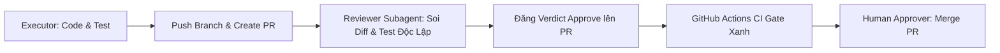

# Hướng Dẫn Điều Phối AI Coding Agents — tra-luat

Tài liệu định hướng và quy chuẩn thống nhất dành cho các trợ lý lập trình AI (Claude Code, OpenAI Codex, Google Antigravity, Cursor, v.v.) khi tham gia phát triển, bảo trì và thẩm định trong kho mã nguồn `tra-luat`.

---

## 1. Ma Trận Vai Trò & Phân Tầng Review

Kho lưu trữ `tra-luat` vận hành theo giao thức đa phiên (*Multi-session Protocol* per `docs/PROTOCOL_DA_PHIEN.md` và `ADR-0017` – `ADR-0035`).

| AI Agent / Provider | Vai trò chính | Chế độ Review | Mức Assurance |
| :--- | :--- | :--- | :--- |
| **Claude Code** | Executor / Cross-Reviewer | Độc lập, sandbox read-only | `cross_approved` (khi review Codex/AG) |
| **OpenAI Codex** | Executor / Cross-Reviewer | Độc lập, sandbox read-only | `cross_approved` (khi review Claude/AG) |
| **Google Antigravity** | Executor / Reviewer dự phòng | Subagent độc lập, read-only | `same_provider_approved` (per ADR-0024) |
| **Human Maintainer** | Approver / Land Operator | Thẩm định và merge exact SHA | `human_audited` |

> [!IMPORTANT]
> **Quy tắc cô lập Reviewer:** Bất kỳ phiên Review nào (dù cùng hay khác provider) BẮT BUỘC phải chạy trong **ngữ cảnh hội thoại riêng** và **thư mục làm việc (Worktree) riêng ở chế độ Read-only**. Bản thẩm định (*Verdict*) phải neo chặt vào mã băm commit chính xác (`reviewed_sha`).

---

## 2. Bất Biến Lõi Cần Tuân Thủ (Core Invariants)

1. **Cấm tuyệt đối ghi đè trực tiếp lên `master`:**
   - Không được commit hoặc push trực tiếp vào nhánh canonical `master`.
   - Mọi thay đổi phải đi qua nhánh riêng (`agent/<packet-name>` hoặc `ops/...`), mở Pull Request (PR), có Reviewer Verdict và vượt qua CI Gate trước khi merge.
2. **Triết lý Fail-Closed:**
   - Mọi cấu hình, định danh phiên bản, thông tin xác thực nếu thiếu, rỗng hoặc hỏng phải **ném lỗi dừng ngay lập tức** (exit code $\neq 0$), tuyệt đối không fallback ngầm về các hằng số lịch sử.
3. **Chuẩn mã hóa UTF-8 trên Windows:**
   - Khi chạy CLI trên console Windows (cp125x), bắt buộc cấu hình UTF-8 cho stdout/stderr:
     ```python
     for _s in (getattr(sys, "stdout", None), getattr(sys, "stderr", None)):
         try:
             _s.reconfigure(encoding="utf-8", errors="replace")
         except Exception:
             pass
     ```
4. **Nguyên tắc VBHN-first (Văn bản hợp nhất):**
   - Khi tra cứu hoặc trích dẫn pháp luật, luôn ưu tiên bản Văn bản hợp nhất mới nhất còn hiệu lực.
5. **Phân loại rủi ro & Nợ Review (Review Debt):**
   - **Nhóm A (Routine):** Sửa tài liệu, chuẩn hóa format, fail-closed, thêm test $\rightarrow$ 0 nợ review.
   - **Nhóm B (Systemic-Low):** Tính năng độc lập, adapter, tiện ích phụ $\rightarrow$ Cần 1 lượt re-audit bổ sung khi Claude/Codex hồi phục quota.
   - **Nhóm C (Sensitive):** Lõi state machine, credential, deploy, security $\rightarrow$ Bắt buộc cross-review đa nền tảng hoặc human audit trước khi land.

---

## 3. Danh Mục Lệnh Kiểm Thử & Chẩn Đoán Bắt Buộc

Trước khi commit và bàn giao bất kỳ thay đổi nào, Agent BẮT BUỘC phải chạy các bài kiểm tra tương ứng trong kho:

```bash
# 1. Kiểm tra bộ selftest của bộ sinh chỉ dẫn
python scripts/gen_instructions.py --selftest

# 2. Kiểm tra tính toàn vẹn các mảnh test fragment
python scripts/tl.py test-fragments-check --json

# 3. Kiểm tra tính nhất quán tài liệu và trích dẫn
python scripts/tl.py doc-claims-check --strict --json

# 4. Kiểm tra tính tất định của các quy trình
python scripts/tl.py determinism-audit --strict --json

# 5. Kiểm tra toàn diện bộ quy tắc phát hành
python scripts/tl.py release-check --full --json

# 6. Đồng bộ và xác minh Package Manifest
python scripts/tl.py release-manifest --out RELEASE_MANIFEST.json --json
python scripts/tl.py release-verify RELEASE_MANIFEST.json --strict --json

# 7. Chạy toàn bộ selftest cốt lõi (1600+ test cases)
python scripts/tl.py --selftest
```

---

## 4. Chu Trình Đăng Tải & Bàn Giao Chuẩn (Handoff Flow)



1. **Executor:** Viết code $\rightarrow$ Chạy test đạt 100% $\rightarrow$ Tạo branch `agent/...` $\rightarrow$ Push $\rightarrow$ Mở PR kèm khối tóm tắt thay đổi và bằng chứng test dương.
2. **Reviewer (Phiên riêng):** Checkout đúng commit $\rightarrow$ Chạy lại test độc lập $\rightarrow$ Soi ranh giới Write-Set $\rightarrow$ Đăng Verdict (với schema `ag_review_verdict.v1` hoặc `review_delivery_receipt.v1`).
3. **CI & Land:** Chờ GitHub Actions `gate` hoàn thành $\rightarrow$ Tiến hành Merge vào `master`.
