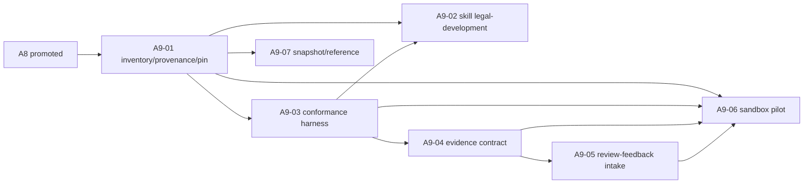

# Kế hoạch triển khai Protocol đa phiên Claude–Codex

- **Trạng thái:** Kế hoạch thi công chi tiết
- **Ngày chốt gốc:** 2026-08-03; **hồ sơ điều chỉnh:** 2026-08-17
- **Nguồn chuẩn:** `docs/PROTOCOL_DA_PHIEN.md`, ADR-0017–ADR-0042; bundle A–G và D1/D2 được chủ kho
  duyệt sau thẩm định chung Claude–Codex ngày 2026-08-17
- **Mục tiêu:** từ repo hiện tại đi tới hai executor Claude/Codex chạy song song an toàn, tự bàn giao,
  tiếp tục qua Windows/cloud/Android và land có phê duyệt.

Tài liệu này là kế hoạch thi công, không thay thế protocol. Ký hiệu
`planned:<repo-relative-path>` chỉ tệp/thư mục sẽ tạo trong pha tương ứng, chưa khẳng định nó đang tồn tại.

> **Active rollout amendment (2026-08-17):** M1–M3 tại §4.1–§4.5 và execution dossier
> `ops/KE_HOACH_THI_CONG_CLAUDE_CODEX.md` điều chỉnh thứ tự thi công hiện tại. Runbook §7–§9 là thiết kế
> long-horizon có từ bản gốc, không phải lệnh để chạy M1–M3. Khi khác nhau, protocol thắng; dossier chỉ giữ cú
> pháp/capability route và không tạo authority.

## 1. Kết quả cuối cùng cần đạt

1. Mỗi mission có Issue, integration branch và draft land PR riêng.
2. Mỗi packet có spec hash, effective write set, executor, environment và lease generation duy nhất.
3. Codex và Claude chỉ ghi trên worktree/branch của packet mình; không hai lease giao nhau.
4. Test mới nằm trong fragment packet-owned; version, changelog hợp nhất, bundled test module và manifest
   chỉ do land gate sinh.
5. Command/handoff vào durable inbox; reconciler single-writer không làm rơi event hay sinh packet trùng.
6. Hết token/quota chuyển `paused` hoặc review fallback có nhãn, không đổi provider âm thầm.
7. Windows tắt không làm mất packet; cloud tiếp tục, packet local chờ controller trở lại.
8. Android đọc prompt/state và gọi cùng operation `land apply` cho exact head SHA.
9. Worker không có credential LIVE; deploy là cổng phê duyệt riêng.
10. Mission Plan, Packet Spec và Session Plan có ranh giới version hóa; thay đổi material đi qua Change Request.
11. Executor, Reviewer, Approver và Land Operator tách vai; evidence/authorization đều neo exact SHA trên GitHub.

## 2. Trạng thái xuất phát và các blocker

Kiểm tại 2026-08-03:

- local `master` ở `e8134a2`, sau `origin/master=ac63cd7` chín commit;
- worktree canonical đang bẩn và có nhiều worktree/phiên khác; không được stage hàng loạt từ cây này;
- Codex CLI `0.146.0` chạy được;
- Claude Code npm `2.1.220` từng trỏ tới binary không hợp lệ cho Windows; bản npm đã được gỡ
  trong preflight nhưng native binary chưa được cài, nên `claude --version` chưa qua;
- `.gitattributes` vẫn `* -text`; `CLAUDE.md` vẫn bắt mọi phiên bump release metadata;
- chưa có fragment harness, change-impact policy, Issue Forms, adapters, dispatcher, reconciler, local controller
  hay `land apply` operation.

Đo lại trong worktree kế hoạch ngày 2026-08-17, base `1a6aedf6`: Claude Code `2.1.233` có `opus`/effort `max`;
Codex CLI `0.146.0` có mặt nhưng doctor trong sandbox chưa live-prove được. Thẩm định sau đó đo trên host
rằng candidate `codex.CMD login status` chạy được, còn GitHub/PyYAML cũng khác theo môi trường. Hai câu cùng
đúng theo fingerprint riêng; mỗi fingerprint phải kèm actor/environment/time và candidate path/error, không được
ghi đè thành kết luận vĩnh viễn về kho hay tài khoản. Mỗi Mission phải chạy lại `launcher.py doctor` và ghi
kết quả; W0-M3 sửa probe candidate trước khi dùng doctor để kết luận auth.

Hệ quả: chưa được chạy hai **writer code** theo protocol ngay. Trước activation, chỉ cho phép hai phiên
read-only hoặc pilot thủ công với write set do người giữ đối chiếu.

## 3. Nguyên tắc chia việc và commit

- Mỗi work packet cho ra một kết quả tự đủ, một PR và một rollback point.
- Mỗi phiên chỉ giữ một vai trò và một đơn vị công việc; substep trong spec ở cùng phiên, việc ngoài spec thành
  successor Packet và phiên mới.
- Không gộp migration EOL, dispatcher, provider adapter và land automation trong một PR.
- PR hạ tầng nhạy cảm phải cross-review hoặc human review; không dùng `review_deferred`.
- Same-provider fallback phải là phiên read-only độc lập và ghi assurance thấp hơn; không giả thành cross-review.
- Executor có thể được ủy quyền làm Land Operator cho exact SHA nhưng không tự trở thành Reviewer/Approver.
- GitHub facts + deterministic reconciler single-writer giữ authority; Executor chỉ phát evidence, reconciler
  mới dispatch Reviewer độc lập. Agent hoặc workflow không tự nối vai trò/transition.
- GitHub Agentic Workflows chỉ là provider adapter/canary sau interface chung, có pinned lock, safe outputs,
  permission tối thiểu và kill switch; public preview không được làm state machine.
- Cho tới khi auto-dispatch được promote, mọi phiên phải đóng gói handoff và prompt Claude/Codex có thể sao chép
  cho vai trò kế tiếp, neo exact SHA/generation và stop conditions.
- Trước activation, foundation PR được land tuần tự theo quy trình release cũ; không chạy song song
  hai PR cùng chạm `scripts/tl.py`, `scripts/tl_selftest.py`, release policy hoặc metadata.
- Sau activation, tối đa hai executor ghi; dispatcher chỉ cấp lease sau khi closure của hai packet không giao.
- Tài liệu, schema, policy và test đi cùng code làm chúng xanh; không tạo PR “code trước, guard sau”.

## 4. Bản đồ rollout


`Foundation complete` chỉ ở F4. `Mission automation complete` chỉ sau A8. A9 là pha hardening mở rộng,
không được chặn hoặc chen vào critical path A2–A8.

### 4.1 Điều chỉnh ưu tiên 2026-08-17 — evidence trước, authority sau

Điều chỉnh này bổ sung các Packet nhỏ vào roadmap hiện hữu, không đổi đích D0–A9. Mỗi Wave chỉ cho tối đa hai
Executor writer và chỉ chạy song song khi effective write set không giao; integration/land vẫn single-writer.

| Wave/Packet | Giá trị độc lập | Ràng buộc triển khai |
|---|---|---|
| **W0-M1** | Sửa summary `launcher_test`: `BO QUA` không được tính là qua | Packet nhỏ, phản chứng pass→skip làm tử số giảm; không gộp với thay đổi launcher khác |
| **W0-M3** | Doctor gọi đúng candidate path và thử candidate kế | Ghi path+lỗi từng candidate; phân biệt probe hỏng với auth không khả dụng; không gộp decode |
| **W0-M4** | Deadline absolute wall-clock sống qua Modern Standby | Wait theo lát, so lại wall deadline; ghi working-state clock đã kiểm chứng; không auto-void |
| **W0-M2** | Làm `launcher.py doctor --json` sạch encoding trên Windows | Đã tái hiện reader thread `cp1258` ném `UnicodeDecodeError` nhưng rc=0; fixture byte không giải mã được phải cho JSON/stderr tất định |
| **W0-R1** | Tách review-call/executor-call/valid-round + Review Rescue Checkpoint trong state machine/tests | Call review đã tốn token tách khỏi round hợp lệ và executor ceiling; Codex review call thứ ba bị từ chối; slice sai dependency/assurance phải đỏ |
| **W0-R2** | Nâng `review_delivery_receipt` hiện có lên v2 | Tách model reviewer/submitter, anchor strength và allowlist 11 legacy receipt; không sửa cổng lease |
| **W0-R3** | Packet state chỉ nhận receipt ID/hash đã validate | Không sao chép raw identity fields thành schema song song; v1 không nâng quyền thành evidence v2 |
| **W0-C1** | Offline fixtures/verifier cho connector | Chưa workflow blocking, chưa credential; cover stale, finding exact-head, missing/ambiguous/API error |
| **W1-P1** | Thống nhất prompt transport launcher và structured verdict schema | Chứng minh prompt thật sự tới model/consumer; schema đúng shape nhưng sai SHA/semantics vẫn đỏ |
| **W1-G1** | Dựng lại base behavior của `gate_lifecycle` trên master mới | Chỉ lấy hành vi/fixture từ WIP cũ; review/land base trước mutation |
| **W1-G2** | Mutation matrix cho `gate_lifecycle.py` | PR riêng sau W1-G1; survivor/mutant không chạy không được biến mất khỏi mẫu số |
| **W1-C2a** | Shadow aggregator thuần từ connector verifier | Không workflow/credential/authority; là Codex Executor candidate nếu budget cho phép |
| **W1-C2b** | Nối verifier vào workflow shadow từ mã default branch | Không execute mã PR; đo positive/finding/missing channels trước khi có quyền chặn; Claude làm Executor |
| **W1-S1** | Đồng bộ `cross-review` adapter với prompt/receipt/state contract đã land | Chỉ sau W1-P1+W0-R3; trước đó giữ prepared sandbox/closed read scope hiện tại và khai transport caveat |
| **W2-A1** | Quyết định positive provider contract sau số đo shadow | Không suy clean từ absence, reaction hoặc `COMMENTED` |
| **W2-A2** | Dedicated App/check blocking nếu W2-A1 chứng minh có nhu cầu | App chỉ là publisher exact-head; không tự nhận là model provenance |

Không cài `gh-aw` trên critical path. Nếu sau này thử, nó chỉ là canary adapter có billing/WIF được duyệt,
feature flag, quota, kill switch và đường lùi như protocol §6.

Nhánh `origin/codex/gate-lifecycle` tại thời điểm điều chỉnh chậm master 158 commit và có ba commit riêng, diff
21 tệp. W1-G1 không rebase/merge nguyên nhánh này: Executor lập inventory behavior/fixture, đối chiếu master rồi
chuyển từng capability còn thiếu thành thay đổi tối thiểu trên base mới. Mỗi capability phải có phản chứng chạy
được; code đã có trong WIP nhưng không còn cần trên master phải bị loại có lý do, không port theo sự hiện diện.

### 4.2 Ba Mission thi công, không dùng mega-Mission

| Mission | Packet | Điều kiện mở | Điều kiện land/đóng |
|---|---|---|---|
| **M1 — Evidence Truth** | W0-M1, W0-M3, W0-M4, W0-M2, W0-R1, W0-R2, W0-R3, W0-C1 | plan/MCR được duyệt; base từ canonical mới nhất | từng capability có phản chứng; land PR riêng; canonical readback trước M2 |
| **M2 — Execution & Shadow** | W1-P1, W1-G1, W1-G2, W1-C2a, W1-C2b, W1-S1 | M1 đã landed và readback; không còn lease M1 | prompt/evidence exact; gate lifecycle base trước mutation; adapter sau contract; shadow không có blocking authority |
| **M3 — Blocking Authority** | W2-A1; W2-A2 chỉ khi A1 chứng minh cần | số đo shadow đủ và threat model được duyệt | canary exact-head/readback/negative fixtures; App/required check chỉ bật sau human approval |

Mỗi Mission có Issue, integration branch và draft land PR riêng; tối đa hai Executor writer với effective write
set không giao. Dependency giữa Mission chỉ được coi là đạt sau canonical readback của Mission trước, không chỉ
vì PR đã merge vào integration. M2/M3 bị pause không giữ lại giá trị của M1; M3 không cần mở nếu connector/provider
contract đã đáp ứng nhu cầu mà không thêm publisher mới.

### 4.3 Ranh giới tự động hóa: Thin Orchestration

V1 không xây thêm daemon/TUI/orchestrator tổng quát và không cài một dự án orchestrator ngoài. Nó mở rộng các
seam hiện có trong `launcher.py`, `packet_loop.py`, ba skill và GitHub Issue/PR bằng thay đổi nhỏ có phản chứng.
Máy chỉ tự quyết định phần tất định: validate schema/state, tính Review Class, giữ budget, neo evidence/exact SHA,
phát hiện Review Rescue Checkpoint và kiểm state transition. Human giữ các quyết định có thể đổi outcome hoặc
authority: chọn Stable Slice, revision Packet/Mission/thiết kế, land và bật Dedicated App/required check.

Auto-dispatch chỉ được đưa ra quyết định promote sau tối thiểu ba Mission thực tế liên tiếp đã landed và canonical
readback, không có stale review/lease, out-of-effective-write-set hay reviewer/publisher identity mismatch. Mỗi
vi phạm reset chuỗi; đủ ba Mission vẫn chỉ tạo promotion proposal cho human duyệt sau negative fixtures, canary
và kill switch. Trong M1–M2, handoff/prompt còn là artifact sao chép được và human là authority điều phối.

Quy tắc này ưu tiên năng lực đã chứng minh hơn sự hiện diện của hạ tầng: mỗi automation mới phải chỉ ra thao tác
thủ công hiện hữu mà nó thay thế, fixture âm chống đường fail-open và phép readback xác nhận kết quả thực tế.

### 4.4 Hai writer slot và hàng đợi ưu tiên

Mỗi Packet dùng một worktree/branch riêng; chỉ chạy tối đa hai Executor writer có effective write set không giao.
Claude Opus/max là mặc định và chiếm ít nhất 70% ngân sách Executor dự kiến mỗi Mission. Codex Executor có trần
30%, chỉ nhận Packet `routine`/`systemic` nhỏ, đóng, độc lập sau khi đã reserve Codex review cho các PR `sensitive`
được chọn và chỉ định human audit cho phần còn lại; tỷ lệ Codex thực có thể bằng 0. Reviewer read-only không chiếm
writer slot, nhưng branch phải đóng băng tại exact PR head cho tới khi verdict được ghi. Không lấp slot bằng việc
chưa đủ dependency/lease hoặc có write-set overlap.

Rework không preempt writer đang chạy. Khi slot kế tiếp mở: cùng priority thì rework đi trước Packet chưa
mở; khác priority thì P cao hơn đi trước rework P thấp hơn. Mọi write set dùng path/prefix repo-relative
có thể so máy; `planned:` chỉ đánh dấu path chưa tồn tại, không thay path bằng prose.

Deadline khởi điểm là 90 phút cho cả Executor và Reviewer, absolute wall clock và fail-closed. Không
tự sửa power policy hay đổi sang active-time. W0-M4 ghi wall/working-state evidence bằng clock đã kiểm
chứng, không auto-void; profile chỉ được xem lại sau 3–5 run thật.

Thứ tự cấp slot là:

1. M1 mở song song **W0-M1** và **W0-R1** bằng Claude. Hai lane serial là
   `W0-M1 → W0-M3 → W0-M4 → W0-M2` và `W0-R1 → W0-R2 → W0-R3`. **W0-C1** là ứng viên
   Codex Executor, lấy slot an toàn đầu tiên sau khi một lane đóng/yield nếu review reservation/trần Mission
   còn đủ; nếu không dùng Claude.
2. M2 mở song song **W1-P1** và **W1-G1** bằng Claude. **W1-G2** chỉ ready sau W1-G1; **W1-C2a** là ứng viên
   Codex Executor, còn **W1-C2b** chỉ ready sau C2a và do Claude thực hiện. **W1-S1** chỉ ready sau
   W1-P1+W0-R3. P0 luôn đứng trước P1.
3. M3 chỉ mở sau M2 canonical readback và quyết định W2-A1; W2-A2 không được giữ slot nếu chưa có bằng chứng cần
   publisher mới.

Khi một Packet vào review, Executor của Packet đó ngừng ghi nhưng writer slot có thể cấp cho Packet độc lập khác.
Sau `changes_requested`, cùng Executor gom finding thành một lượt vá trước rereview; không gọi Codex xen giữa từng
finding. Scheduler phải ghi lý do khi bỏ qua Packet ưu tiên cao hơn, không chỉ ghi rằng một slot đang trống.

Path map M1/M2 được đóng băng chi tiết trong `ops/KE_HOACH_THI_CONG_CLAUDE_CODEX.md`; đáng chú ý,
W0-R2 không chạm `ops/lease_publish.py`, W1-G2 chỉ sửa test/mutation runner và W1-S1 chỉ sửa
`.claude/skills/cross-review/SKILL.md`.

### 4.5 Evidence review chưa phải GitHub authority

Trong M1–M2, Codex review chạy read-only qua `launcher.py`; evidence neo exact PR head, output hash và
`model_reviewer_identity`. Nếu một human/Claude session chép hoặc đăng kết quả, nó ghi đúng
`github_submitter_identity` riêng. Evidence hợp lệ có thể đạt assurance `cross_approved` trong Packet state nhưng
không phát required check, không tự authorize merge và không được đọc tài khoản tác giả thành reviewer độc lập.
Packet `sensitive` cần human Land Approver readback verdict/receipt trên exact head trước khi land.

W2-A1 chỉ quyết định contract positive sau shadow. W2-A2 chỉ dựng Dedicated App/Check Run khi cần publisher
authority độc lập; canary phải chứng minh exact-head, identity readback và negative path trước human activation.
Receipt nằm trên PR branch chỉ là mirror, không phải trust root của required check.

W0-R2 nâng receipt hiện có lên v2 thay vì dựng record song song. Identity bắt buộc cho receipt mới; 11 receipt
v1 cũ giữ nguyên, historical/read-only và không đủ cho identity required check mới. Miễn trừ legacy dùng
allowlist đóng băng filename+hash, không tin `schema_version` do tác giả tự khai. W0-R3 nối receipt ID/hash đã
validate vào state; không sao chép raw identity fields.

## 5. Kế hoạch work packet chi tiết

### D0 — Bootstrap tài liệu trên worktree sạch

| Packet | Nội dung | Phụ thuộc | Nghiệm thu |
|---|---|---|---|
| D0-01 | Tạo worktree từ `origin/master`; mang sang CONTEXT, protocol, ADR-0017–0033, research và kế hoạch này | không | diff chỉ docs/CONTEXT; không cuốn runtime bẩn |
| D0-02 | Chuẩn hóa liên kết, planned path và con trỏ tài liệu | D0-01 | `doc-claims-check --strict`, link check, `git diff --check` xanh |
| D0-03 | PR docs-only và review chéo/human | D0-02 | merge vào canonical; ghi base SHA cho foundation |

Kill switch: nếu PR có runtime diff hoặc doc gate đỏ, đóng PR và tạo lại từ worktree sạch; không “dọn”
canonical bằng reset.

### T0 — Toolchain và GitHub baseline

| Packet | Nội dung | Phụ thuộc | Nghiệm thu |
|---|---|---|---|
| T0-01 | Gỡ cài Claude npm bị lệch platform; cài một bản native/WinGet duy nhất | D0 | `claude --version`, `claude doctor`, login và workspace trust qua |
| T0-02 | Kiểm Codex CLI/app, Git, Python, PowerShell và GitHub capability route bằng launcher doctor | D0 | đo khả dụng chứ không chỉ PATH; remote dùng MCP GitHub + git khi đó là route khỏe; không cài `gh` để chữa môi trường không dùng nó |
| T0-03 | Chốt nhãn, environment và actor allowlist trên GitHub | D0 | có owner, backup owner và test account không quyền |
| T0-04 | Kiểm kê worktree/PR/branch đang sống | D0 | mỗi writer có owner và quyết định finish/push/close |

T0 không thêm provider secret vào GitHub.

### F1 — Test fragment và bundled topology

Pha này tuần tự vì chạm legacy harness/release. Đích file đã chốt:
`scripts/test_fragments/`, `scripts/tl_core/test_fragments.py` và
`scripts/tl_test_fragments_bundled.py`.

| Packet | Write set chính | Kết quả | Nghiệm thu |
|---|---|---|---|
| F1-01 | legacy harness + loader mới | API discover fragment theo tên tất định; từ chối ID/path sai | fixture root tạm: zero/one/many/duplicate/malformed |
| F1-02 | loader + resolver doc/test ID | registry lập chỉ mục cả `rNNN_*` và `wp<issue>_<slug>` | legacy pointer, wp pointer và fake pointer có phản chứng |
| F1-03 | generator + release predicate | sinh bundled module UTF-8/LF; exclude đúng canonical prefix | byte output giống Windows–Linux; basename cùng tên ở chỗ khác không bị loại |
| F1-04 | release required files/topology | dev chạy fragment; bundle chỉ mang bundled module | thiếu bundled module fail đích danh; bundle dưới trần file |
| F1-05 | một regression test canary | chuyển/thêm một test mới bằng wp ID | legacy selftest và fragment test cùng xanh |

Promotion gate F1: full selftest, release behavior, determinism và parity hai OS xanh; generator và module
không có hai implementation khác nhau.

### F2 — Migration EOL có drain

| Packet/commit | Nội dung | Nghiệm thu |
|---|---|---|
| F2-00 | Freeze writer mới; owner của mọi worktree push/handoff/close | danh sách writer về zero; chốt EOL base SHA |
| F2-A | `.gitattributes`, `.editorconfig`, validator blob-index và hook Python | test file mới, Unicode, space, LF/CRLF; hook không chỉ so với HEAD |
| F2-B | Chỉ `git add --renormalize .` | diff chỉ newline; không thay nội dung logical |
| F2-C | Tái sinh manifest/golden/artifact | Windows–Linux cùng blob/hash và full gate xanh |
| F2-D | Mở lại writer | mọi branch cũ rebase trên EOL base; branch chưa rebase bị chặn |

F2-D phải có Packet Issue và phiên vận hành riêng trước khi mở lại writer. Nếu Mission F2 hiện hành từng coi F2-D
chỉ là checklist nội bộ, việc tách này đi qua Mission Change Request; không sửa ngầm kế hoạch sau khi F2-A/B/C đã land.

Rollback: chỉ quay lại trước F2-A khi chưa merge. Sau merge, không revert riêng F2-B; pause và sửa
policy/parity bằng maintenance PR mới.

### F3 — Protocol, safety và hai CI lane

Sau F2, có thể chạy tối đa hai packet trong các nhóm ghi không giao. Các tệp mới dưới
`planned:.github/coordination/` và `planned:.agents/skills/` là dev-side, phải bị loại khỏi release bundle.

| Packet | Nhóm ghi | Nội dung | Phụ thuộc |
|---|---|---|---|
| F3-00 | Governance contract | glossary; MCR/revision; durable orchestration; `gh-aw` adapter boundary; tiered selftest; manual successor prompt; review/land authority; ADR | MCR-54-02 |
| F3-01 | GitHub schema | Issue Forms mission/packet/change request, JSON schema handoff/review/land/state/command, `review_class` khai báo + effective | F2, F3-00 |
| F3-02 | Impact policy | policy/schema/stdlib validator, closure có hướng, review-class classifier fail-closed, candidate report read-only | F2, F3-00 |
| F3-03 | Agent adapters | `work-packet`, `cross-review`, `land-packets`; `CLAUDE.md` và `AGENTS.md` chỉ trỏ protocol | F2, F3-00 |
| F3-04 | Security | permissions tối thiểu, security paths, CODEOWNERS, cấm LIVE credential trong worker | F2, F3-00 |
| F3-05 | Derived metadata | `planned:changelog.d/`, worker cấm version/r number, land-owned metadata | F1, F2, F3-00 |
| F3-06 | Worker gate | classifier + aggregator; manifest tạm ngoài repo; fragment tests; evidence/write-set/EOL/security checks; không provider secret | F3-01…05 |
| F3-07 | Land gate | generate bundled/changelog/version/manifest, parity, dry-run `land prepare` | F3-01…06 |
| F3-08 | Adapter parity | test Claude/Codex adapter cùng schema, role/session boundary, stop condition và completion contract | F3-03, F3-06 |

Không cho F3-06 và deferred numbering active riêng. Cả hai chỉ bật trong F4.

### F4 — Zero-legacy cutover

1. Inventory mọi PR/branch còn ghi version, changelog hoặc manifest.
2. Merge, đóng hoặc chuyển chúng sang packet v1; không gán lane theo tuổi branch.
3. Chạy worker gate và land gate trên ba fixture: code-only, docs-only, fragment-only.
4. Land activation PR ghi `protocol_version: 1` và `protocol_cutover_sha`.
5. Chuyển required checks một lần; xóa/disable legacy writer path.
6. Chạy hai packet canary thủ công, write set không giao, một Codex và một Claude.

Foundation gate chỉ xanh khi hai canary cùng qua worker gate, merge tuần tự vào integration và land mà
không ai sửa release metadata trên worker branch.

### A2 — Test economics và gate selftest phân tầng

Pha này được ưu tiên ngay sau F4 và trước model orchestration để giảm chi phí của mọi canary sau. Không activate
selector bằng cách lọc output của harness eager hoặc shard modulo; full suite hiện hành vẫn là oracle trong thời
gian shadow.

Bootstrap pre-selector được phép land sớm: exact-head evidence wrapper, fail-closed reuse validator, targeted-first
runbook và semaphore `heavy_gate=1` trên mỗi host. Bootstrap này chỉ loại **duplicate execution** của cùng exact
identity; nó không deselect test và không thay promotion gate A2. `.github/workflows/ci.yml` phải checkout PR head
tường minh trước khi gọi evidence wrapper; run chỉ “associated with” head nhưng test synthetic merge ref không được
nhận là exact-head evidence.

| Packet | Kết quả | Nghiệm thu/promotion |
|---|---|---|
| A2-01 | duration/event instrumentation và stable catalog cho 1.696 ca | báo top cost theo group/callable; instrumentation không đổi verdict |
| A2-02 | tách callable/group, fake clock/temp và cleanup global state | group chạy độc lập, đảo thứ tự không đổi kết quả |
| A2-03 | bỏ subprocess/golden lặp, cache parser an toàn, sửa nghĩa/help `release-check --full` | golden chỉ chạy một lần/checkpoint; help và behavior cùng test |
| A2-04 | parallel full theo process/group trên Windows + Linux | tổng hợp tất định, failure/log không mất, serial/full parity |
| A2-05 | affected-test selector chạy shadow 2–4 tuần | mọi T1/T2 selection so với full; false-negative bằng 0; unknown luôn full |
| A2-06 | activate policy T0–T5, exact-identity reuse và rollback switch | classifier + aggregator required; fixture path/risk/catalog/security/release/EOL fail-closed |

Promotion gate A2: median packet feedback giảm có số đo; T3 full hai OS vẫn giữ; không đổi số/ý nghĩa ca test;
selector policy/catalog/runner được version hóa và evidence đủ để dựng lại vì sao một group chạy hoặc bị bỏ.

### A3 — Dispatcher shadow, chưa gọi model

Mã orchestration dev-side đặt dưới `planned:.github/coordination/`; workflow chỉ gọi core này. Mỗi module
có contract nhỏ, test bằng fake GitHub store; không mock qua HTTP mạng.

| Packet | Kết quả | Có thể song song với |
|---|---|---|
| A3-01 | pure domain model, state transition, schema/versioning | A3-02 |
| A3-02 | durable inbox fact, projection, event journal và hash-chain checkpoint | A3-01 |
| A3-03 | reconciler sort `(created_at,id)`, idempotency và pagination | không; phụ thuộc 01–02 |
| A3-04 | lease/generation/heartbeat/takeover và stale fencing | A3-05 nếu file không giao |
| A3-05 | path normalization, change-impact closure và global write-set exclusion | A3-04 |
| A3-06 | successor dedupe, budget reservation và circuit-breaker state | sau A3-03 |
| A3-07 | integration branch/PR planner dry-run | sau A3-03–06 |
| A3-08 | shadow workflow: issue trigger chỉ wake; scheduled/manual reconcile | sau 01–07 |
| A3-09 | stress fixtures: burst, reordered wake, retry, edit/delete, overflow, projection loss | sau A3-08 |

Promotion gate A3: zero model call, zero provider secret, zero canonical write. Ba inbox fact burst không mất;
retry cùng ID chỉ apply một lần; chain hỏng chuyển `paused` có audit.

### A4 — Cloud canary một provider

1. A4-01: provider-neutral executor interface và output schema.
2. A4-02: implementation canary có thể là GitHub Agentic Workflows hoặc runner native sau cùng interface;
   `gh-aw` Markdown compile/pin lock, safe outputs, read-only mặc định và feature flag/kill switch.
3. A4-03: OIDC broker là đích; secret provider trực tiếp chỉ là bước chuyển tiếp có owner/expiry.
4. A4-04: chọn provider theo credential có thể scope/quota; một packet offline,
   `max_parallel_workers=1`, không successor/security path và không dùng session token cá nhân chép vào prompt/repo.
5. A4-05: thu hồi credential và quota test; workflow branch code không nhìn thấy credential.

Nếu tài khoản không có credential automation được hỗ trợ, A4 `paused`; không lách bằng raw cookie/token.

### A5 — Dual provider và review phân tầng

- A5-01: adapter Claude và Codex cùng executor contract; cấu hình vận hành mặc định Claude Code
  `--model opus --effort max` làm Executor code chính; Mission budget dành Claude tối thiểu 70%, trần Codex
  Executor 30% sau khi reserve review, không ép tiêu đủ trần.
- A5-02: reconciler nhận Executor evidence, validate exact identity rồi tự dispatch reviewer context/worktree mới,
  read-only; verdict schema `approve|changes_requested|blocked`.
- A5-03: `cross_approved`, `human_audited` (GitHub identity bền, độc lập, audit evidence + verdict trên exact SHA),
  `same_provider_approved`, `review_deferred` và các risk không được defer.
- A5-04: rate-limit/quota fingerprint, reset time và circuit breaker; quota failure không tính attempt nội dung.
- A5-05: canary hai packet không giao; Claude review Codex và Codex review Claude.
- A5-06: `changes_requested` trả stable finding IDs cho Executor generation hợp lệ; commit mới tự thu hồi verdict,
  CI và authorization cũ; approve mới cho phép frontier kế tiếp.
- A5-07: review-budget router chỉ cấp Codex cho Packet giá trị/rủi ro cao và tối đa hai lượt mỗi PR; lượt hai
  chưa approve sinh checkpoint tách/xem lại thiết kế, không tự gọi lượt ba. Fixture phải chứng minh Packet thường
  fallback đúng `same_provider_approved`/`human_audited`, còn phạm vi nhạy cảm vẫn dừng chờ Codex hoặc human audit.
- A5-07a: state tách `codex_review_calls_used`, `codex_executor_calls_used` và `review_rounds_used`; call review đã
  sinh output/token vẫn tiêu review cap khi timeout/sai schema, còn preflight/permission/rate-limit trước generation
  không tiêu call. Raw output sai schema fail-closed, không auto-retry; đổi prompt/session không reset bộ đếm.
  Review cap và executor ceiling không vay lẫn nhau.
- A5-08: Review Rescue Checkpoint dựng Stable Slice thành Packet/PR sạch và Remediation Slice thành successor,
  bảo toàn finding IDs/dependency/audit. Fixture phải làm đỏ khi slice phụ thuộc phần lỗi, thiếu acceptance riêng,
  làm yếu gate, tái dùng review SHA cũ hoặc cùng hình dạng lỗi lần ba vẫn bị đưa về rework thường.
- A5-09: review-class router lấy mức cao hơn giữa khai báo và classifier; unknown/error thành `sensitive`,
  Executor không hạ lớp. Fixture cover ba lớp, ngưỡng ba downstream consumer, path authority/security và human
  override có audit; quota reservation/report tách theo lớp để chứng minh Codex không bị dùng cho `routine`.

### A6 — Successor tự động và Android

- A6-01: validate handoff và successor key; retry workflow không sinh Issue trùng.
- A6-02: enforcement `max_packets`, depth, attempt, run minute, invocation và cloud minute.
- A6-03: `used/reserved/limit`, preflight `budget_infeasible` và PAUSE thay vì tiêu hết token.
- A6-04: parser/authorization chung cho comment và typed workflow dispatch.
- A6-05: GitHub Mobile test: start/pause/resume/reroute và `land apply` stale-head negative test.

### A7 — Local controller trên Windows

Controller nằm dưới `planned:.github/coordination/local_controller.py` hoặc wrapper rất mỏng gọi cùng
core; không tạo generic self-hosted runner.

| Packet | Nội dung | Nghiệm thu |
|---|---|---|
| A7-01 | poll packet local, validate lease, tạo worktree/branch | reboot không sinh worktree/branch trùng |
| A7-02 | launcher `codex exec` và `claude -p`, timeout, JSON handoff | process exit/timeout/quota được phân loại |
| A7-03 | heartbeat và stale-generation kill | worker cũ không push/handoff sau takeover |
| A7-04 | Scheduled Task dưới tài khoản ít quyền | log không secret; start-at-boot/recovery test |
| A7-05 | cleanup sau canonical readback | không xóa worktree bẩn/stale còn cần preserve |

### A8 — Land automation và completion

1. `land prepare`: freeze mission, exact integration head, generate derived files, parity/full gate, draft PR.
2. `land apply`: pure operation không model call, không sửa diff; kiểm actor, environment approval, exact SHA.
3. Ba client: local skill, authorized Issue comment và typed `workflow_dispatch`.
4. Neo mission ID + final state hash vào canonical; readback khớp rồi mới `complete`/cleanup.
5. Deploy LIVE vẫn là operation khác, không tự chạy sau merge.

Promotion gate A8: chạy nhiều mission liên tiếp không stale lease, event loss, duplicate packet,
out-of-effective-write-set hay sai derived metadata; stale SHA và actor lạ bị từ chối có audit.

### A9 — Skill engineering và tiếp nhận upstream có kiểm soát

Pha này chỉ bắt đầu sau khi A8 đã promote. Không vendor/cài toàn bộ một bộ skill cộng đồng vào runtime package;
mọi tiếp nhận phải provider-neutral, pin exact upstream identity, có provenance và qua behavior fixtures. Workflow,
plugin hoặc persona bên ngoài chỉ là adapter/tư vấn, không được nhận authority dispatch, review, land, merge hay deploy.

Số thứ tự packet KHÔNG tạo dependency. Chỉ cột `Phụ thuộc` dưới đây có hiệu lực, và nó ánh xạ thẳng sang
`depends_on` của Packet Issue (`docs/PROTOCOL_DA_PHIEN.md` §3.2). Theo §5 của cùng tài liệu, packet chỉ được
dispatch sau khi TẤT CẢ predecessor đã integrated vào `mission/<issue>/integration`; accepted, approved hay
mới mở PR đều chưa đủ, và dispatcher không cấp lease cho packet còn predecessor chưa integrated. Ngoài cột
đó, mọi packet A9 mang thêm predecessor ngầm định `A8 promoted`: A9 không mở khi A8 chưa promote.

| Packet | Kết quả | Phụ thuộc | Nghiệm thu/promotion |
|---|---|---|---|
| A9-01 | inventory nguồn, license, exact upstream commit/version, telemetry/network surface và owner/update policy | A8 promoted | lock/provenance dựng lại được; auto-update từ nhánh động bị cấm; chưa đổi runtime |
| A9-02 | skill `source-driven-legal-development` provider-neutral | A9-01, A9-03 | ưu tiên nguồn chính thức; ghi version/ngày hiệu lực/deep link; nội dung truy xuất là dữ liệu không đáng tin; conflict với protocol/spec phải được báo, không tự giải quyết |
| A9-03 | skill conformance/eval harness | A9-01 | fixture kiểm trigger, progressive disclosure, tool allowlist/denylist, prompt injection, one-task/one-role, exact-SHA drift và package/token budget |
| A9-04 | verification evidence contract và negative/mutation fixtures cho completion claim | A9-03 | claim gắn command mới chạy, exact identity, runner/OS, rc + số đếm dương; gate giả hoặc thiếu bằng chứng phải fail |
| A9-05 | review-feedback intake dùng stable finding ID | A9-04 | finding neo reviewed SHA/spec; Executor xác minh rồi sửa và chỉ phát `ready_for_rereview`; commit mới thu hồi verdict/evidence cũ; reply đúng review thread khi có |
| A9-06 | sandbox pilot allowlist `verification-before-completion`, `systematic-debugging`, `receiving-code-review` | A9-01, A9-03, A9-04, A9-05 | user-level/dev-side, pin version, telemetry off, zero authority; promote/pause/rollback theo đúng tiêu chí ở tiểu mục dưới, không theo phép đọc số tự do |
| A9-07 | snapshot/reference dev-side đã pin cho Claude/Codex adapter practices | A9-01 | không vào runtime package; claim về provider feature được đối chiếu tài liệu chính thức; update chỉ qua reviewed diff |



Vì sao fan-in của A9-06 rộng: pilot chỉ đo được khi đã có pin/provenance của đúng bản upstream (A9-01), harness
bắt được trigger conflict và vi phạm one-task/one-role (A9-03), và hợp đồng bằng chứng cho completion claim
(A9-04). Allowlist pilot chứa `receiving-code-review`, nên A9-05 phải integrated trước để review-feedback intake
là hợp đồng của ta; chạy ngược lại thì chính skill upstream định nghĩa review lane, đúng thứ A9 cấm. Thiếu bất kỳ
predecessor nào thì A9-06 không được dispatch, kể cả dưới dạng thử nghiệm thủ công ngoài packet.

A9-07 chỉ tiếp nhận snapshot/reference cho nguồn ĐÃ nằm trong inventory/provenance/pin của A9-01 đã integrated.
Nguồn chưa có trong inventory đi qua revision A9-01 mới; không mở rộng write set của A9-07 và không snapshot
trước rồi kiểm kê sau.

A9 không tạo một self-review lane mới. Chỉ deterministic reconciler của A3–A8 được dispatch task Reviewer độc lập;
persona/skill không gọi persona có authority. Pattern đo-trước-tối-ưu được triển khai tại A2, không trì hoãn sang A9.

#### Tiêu chí promote/pause/rollback của pilot A9-06

Baseline đo TRƯỚC khi bật allowlist, trên cùng tập packet fixture, cùng runner/OS, cùng exact SHA và cùng catalog
A2; lượt baseline và lượt pilot dùng cùng số lần lặp rồi ghi cùng một bộ số. Không có baseline dựng lại được thì
số đo của pilot là dữ liệu quan sát, không phải promotion evidence.

| Chỉ số | Định nghĩa đo | Chiều/ngưỡng đạt | Trigger pause/rollback |
|---|---|---|---|
| rework do thiếu bằng chứng | số packet phải làm lại vì completion claim bị fixture A9-04 hoặc Reviewer bác | giảm so với baseline; đây là chiều lợi ích duy nhất cho phép promote | không giảm |
| trigger conflict | số lần từ hai skill trở lên cùng claim một task, hoặc skill kích hoạt ngoài trigger đã khai ở A9-01 | phải bằng 0, suy ra từ one-task/one-role chứ không phải chỉ tiêu thương lượng | bất kỳ lần nào lớn hơn 0 |
| token | tổng input cộng output token trên mỗi packet, lấy median và p95 | không vượt baseline nhân ceiling đã chốt; neo vào `used/reserved/limit` của A6-03, không tạo cơ chế budget thứ hai | vượt ceiling |
| latency | wall-clock trên mỗi packet, lấy median và p95 | không vượt baseline nhân ceiling đã chốt | vượt ceiling |

Rollback trigger không phụ thuộc số đo, áp dụng song song: conformance hoặc negative fixture của A9-03/A9-04 đỏ;
phát hiện escalation authority, network hay telemetry ngoài allowlist; skill upstream đổi identity so với pin của
A9-01. Bất kỳ trigger nào bật thì gỡ khỏi sandbox trước, phân tích sau.

Ceiling token/latency, số lần lặp và cửa sổ đo là quyết định material của Mission A9 và HIỆN CHƯA ĐƯỢC CHỐT; kế
hoạch này không tự đặt ngưỡng thay Mission. Tới khi human hoặc MCR của Mission A9 ghi các giá trị đó vào Packet
Spec A9-06, pilot chỉ được `pause` hoặc rollback và KHÔNG được promote. Thiếu ngưỡng là fail-closed, không phải
quyền diễn giải của phiên đang chạy.

Promotion gate A9: behavior và negative fixtures xanh; provenance/license/pin đầy đủ; không tăng authority hoặc
network surface ngoài allowlist; riêng pilot A9-06 xét theo đúng tiểu mục tiêu chí ở trên chứ không theo phán đoán
"lợi ích đo được". Nếu không đạt, giữ upstream ở trạng thái tài liệu tham khảo dev-side hoặc rollback khỏi sandbox.

## 6. Ma trận song song theo pha

| Pha | Số writer tối đa | Điều kiện |
|---|---:|---|
| D0–F2 | 1 | canonical bẩn, release metadata/EOL/harness là nút toàn cục |
| F3 trước activation | 2 do người giữ | worktree riêng, write set/closure đối chiếu thủ công |
| F4 canary | 2 | một Claude, một Codex; không giao effective write set |
| A2 test economics | 1 với harness/runner; 2 cho read-only profiling | full oracle giữ tuần tự tới khi isolation/parallel parity xanh |
| A3 shadow | 2 | chỉ fake store/dry-run; zero model/secret/canonical write |
| A4 cloud canary | 1 | một provider, một packet, không successor |
| A5–A8 | 2 mặc định | dispatcher cấp lease; integration/land vẫn single-writer |
| A9 skill engineering | 2 nếu write set không giao | core skill/eval single-writer; upstream research/pilot chỉ read-only hoặc sandbox độc lập |

## 7. Runbook cài đặt và kiểm tra Windows

> **Không dùng mục 7–9 để khởi động M1–M3.** Đây là runbook đích của kế hoạch gốc. Rollout hiện tại dùng
> `ops/KE_HOACH_THI_CONG_CLAUDE_CODEX.md`, chạy `launcher.py doctor` trước rồi chọn route theo capability thực;
> không gỡ/cài công cụ hay dùng `gh` chỉ vì ví dụ lịch sử dưới đây có lệnh đó.

### 7.1 Sửa Claude Code trước

Máy hiện không có Microsoft Desktop App Installer/WinGet, vì vậy dùng native installer chính thức
của Anthropic là đường chuẩn. Chỉ giữ một installation. Thực hiện trong PowerShell 64-bit bình
thường, không cần Administrator:

```powershell
where.exe claude
npm uninstall -g @anthropic-ai/claude-code
irm https://claude.ai/install.ps1 | iex

# Mở PowerShell mới, rồi kiểm:
where.exe claude
claude --version
claude doctor
```

WinGet chỉ là phương án phụ khi `Get-Command winget.exe` trả về lệnh hợp lệ:

```powershell
winget install Anthropic.ClaudeCode
```

Nếu `where.exe claude` còn nhiều bản, dừng và gỡ bản cũ trước khi chạy. Không chép credential
Claude vào repo hay worktree. Chạy `claude` một lần trong repo để login và accept workspace trust.

### 7.2 Kiểm Codex, Git và GitHub

```powershell
codex --version
codex doctor
git --version
gh --version
gh auth status
python --version
pwsh --version
```

Không dùng `--dangerously-bypass-approvals-and-sandbox`. Codex executor dùng `workspace-write`; reviewer dùng
`read-only`. Trên Claude native Windows, protocol/hook/permission phải chặn write cho reviewer vì native Windows
không có sandbox tương đương WSL2.

## 8. Runbook chạy Codex và Claude đồng thời

Runbook này dùng sau F4 activation. Trước F4, chỉ dùng nó như pilot có người giữ claim và không
cho hai agent chạm code/metadata dùng chung.

### 8.1 Tạo mission và hai packet không giao

Ví dụ:

- `wp101`: Codex, chỉ sửa module A và fragment `wp101_*`;
- `wp102`: Claude, chỉ sửa module B và fragment `wp102_*`;
- không packet nào sửa VERSION, `CHANGELOG.md`, manifest, bundled module, security path hay integration branch.

Trên GitHub, tạo mission Issue và hai packet Issue. Đóng băng objective, acceptance, write set, dependency,
executor và environment trước khi claim. Nếu chưa có dispatcher, người giữ phải tự tính closure và xác
nhận hai tập không giao.

Nếu objective/acceptance/risk/envelope hoặc đồ thị Packet của Mission cần đổi, ghi Mission Change Request, pause
phần bị ảnh hưởng, lập impact analysis và chờ human approval trước revision/plan hash mới. Không chỉnh body rồi để
lease cũ tiếp tục. Packet đổi contract phải revision + generation mới; thay đổi Session Plan trong spec thì không.

### 8.2 Tạo integration branch và hai worktree

```powershell
$Repo = 'D:\Quốc hội\tra-luat'
$WtRoot = 'D:\Quốc hội\tra-luat-wt'
$Mission = 100

New-Item -ItemType Directory -Path $WtRoot -Force | Out-Null
git -C $Repo fetch origin master

git -C $Repo branch "mission/$Mission/integration" origin/master
git -C $Repo push -u origin "mission/$Mission/integration"

git -C $Repo worktree add "$WtRoot\wp101-codex" -b "agent/wp101-g1-codex" origin/master
git -C $Repo worktree add "$WtRoot\wp102-claude" -b "agent/wp102-g1-claude" origin/master
git -C $Repo worktree list
```

Không tạo hai phiên trong cùng thư mục. Không dùng current dirty `master` làm base. Không thêm secret
vào `.worktreeinclude`; nếu packet cần tài nguyên local có credential, dừng và route sang local operation
được thiết kế riêng.

### 8.3 Mở Codex executor

Trong PowerShell thứ nhất:

```powershell
$CodexWt = 'D:\Quốc hội\tra-luat-wt\wp101-codex'
codex -C $CodexWt -s workspace-write -a on-request
```

Prompt ban đầu:

```text
Đọc docs/PROTOCOL_DA_PHIEN.md và AGENTS.md.
Nhận packet wp101, generation 1, executor codex, branch agent/wp101-g1-codex.
Chỉ sửa effective write set ghi trong Issue <URL>.
Không sửa VERSION, CHANGELOG.md, RELEASE_MANIFEST.json, bundled test module, security path hoặc file ngoà set.
Thêm regression test trong fragment wp101_*; chạy worker gate.
Khi xong, commit/push branch, mở PR vào mission/100/integration và xuất handoff đúng schema.
Nếu closure thiếu, generation/spec sai, cần LIVE hoặc gần hết budget: PAUSE, không tự nới quyền.
```

Headless sau A7 dùng cùng packet prompt/schema:

```powershell
$HandoffSchema = 'D:\Quốc hội\tra-luat\.github\coordination\schemas\handoff.v1.schema.json'
$HandoffJson = 'D:\Quốc hội\tra-luat-wt\wp101-codex\.coord\handoff.json'
$PacketPrompt = 'Thực thi packet wp101 từ Issue URL theo Protocol v1.'
codex exec -C $CodexWt -s workspace-write --output-schema $HandoffSchema -o $HandoffJson $PacketPrompt
```

### 8.4 Mở Claude executor

Trong PowerShell thứ hai:

```powershell
$ClaudeWt = 'D:\Quốc hội\tra-luat-wt\wp102-claude'
Set-Location -LiteralPath $ClaudeWt
claude --remote-control 'wp102-claude'
```

Prompt giống Codex nhưng thay packet/executor/branch thành `wp102`, `claude`, `agent/wp102-g1-claude`.
`--remote-control` cho phép theo dõi phiên local trên Android; máy Windows và process Claude vẫn phải thức.
Muốn máy tắt mà việc tiếp tục thì packet phải route `environment: cloud`, không phải Remote Control.

Claude Code cũng có `claude --worktree <name>`, nhưng runbook này tạo worktree bằng Git để branch,
generation và base SHA khớp lease contract, thay vì để client tự đặt tên.

### 8.5 Theo dõi và chặn trùng việc

Người giữ hoặc dispatcher kiểm bốn thứ, không chỉ nhìn label:

1. packet ID/generation/spec hash;
2. branch và worktree path;
3. effective write set + policy SHA;
4. heartbeat/lease expiry.

Mở rộng write set phải pause cả packet, tạo revision/generation mới rồi mới tiếp tục. Không nhắn hai
agent “tự chia nhau file” trong chat.

### 8.6 Review chéo và integrate

- Claude PR do Codex review read-only; Codex PR do Claude/human review read-only.
- Reviewer không checkout và ghi vào executor worktree.
- Nếu provider kia hết quota, reviewer cùng provider phải ở phiên/context/worktree mới, ghi
  `same_provider_approved`; packet nhạy cảm vẫn cần cross-provider hoặc human audit.
- Review evidence ghi exact SHA, hai trục Spec và Standards/Security, test tự chạy, findings và verdict. Head đổi
  làm approval cũ hết hiệu lực.
- Mỗi PR rebase trên integration head mới và chạy lại worker gate trước merge.
- Dispatcher/người giữ merge từng PR vào integration, không cho hai executor tự merge.

Codex review thủ công có thể chạy trong checkout reviewer riêng:

```powershell
codex exec -C <review-worktree> -s read-only review --base origin/mission/100/integration `
  'Review theo Spec và Standards/Security; không sửa file; xuất verdict có evidence.'
```

Sau cùng, land worktree duy nhất sinh version/changelog/bundled module/manifest và draft PR vào canonical. Approver
ủy quyền exact head SHA; Land Operator chỉ thực hiện điều kiện đã ghi. Executor có thể làm operator nhưng không tự
review/approve diff của mình. Merge vào integration là `integrated`; chỉ canonical + hậu-merge gate + bookkeeping
mới là `landed`.

### 8.7 Kết thúc và dọn worktree

Chỉ dọn sau khi PR đã integrated/landed, handoff đã ghi, branch clean và canonical readback khớp:

```powershell
git -C "$WtRoot\wp101-codex" status --short
git -C "$WtRoot\wp102-claude" status --short
git -C $Repo worktree remove "$WtRoot\wp101-codex"
git -C $Repo worktree remove "$WtRoot\wp102-claude"
git -C $Repo worktree prune --dry-run
```

Nếu `status --short` không rỗng, dừng; không `--force`, không xóa thư mục bằng tay.

## 9. Tiếp tục từ Android

Ba bề mặt có vai trò khác nhau:

- **GitHub Mobile:** control plane bền; đọc Issue/PR/check, approve, chạy typed workflow và gọi `land apply`.
- **Claude app/Code tab:** theo dõi cloud session hoặc Remote Control tới host local; local host phải online.
- **ChatGPT Mobile/Remote tab:** tiếp tục Codex task trên host Windows đã pair; host giữ file, shell và credential.

Checklist:

1. Cập nhật app desktop/mobile, pair từng thiết bị với host.
2. Đặt tên task theo `wp<issue>-<executor>` để không chọn nhầm phiên.
3. Trên điện thoại chỉ steer/approve; không dùng chat history làm state chính.
4. Khi host tắt, theo dõi packet cloud qua GitHub; packet local phải ở `paused`/queued.
5. Land từ Android phải nhập/chọn exact `mission_id` và `head_sha`; stale SHA phải bị từ chối.

## 10. Evidence và báo cáo mỗi promotion gate

Mỗi epic lưu một report non-normative gồm:

- base/head SHA, protocol version, policy SHA;
- packet/PR/workflow run IDs;
- gate matrix Windows–Linux;
- budget `used/reserved/limit` và provider error fingerprint;
- race/negative tests đã chạy;
- secret inventory theo **tên** secret, không ghi giá trị;
- kill switch/rollback đã test;
- quyết định promote, pause hay rollback và người duyệt.

Ngoài report epic, mỗi transition giữ evidence tối thiểu ngay trên GitHub:

- **Executor:** provider/role/session/generation, base/head SHA, changed paths, RED/GREEN hoặc phản chứng, lệnh/rc và
  số đếm dương, việc chưa chạy, handoff/successor;
- **Reviewer:** phiên độc lập, reviewed SHA, Spec + Standards/Security, test tự chạy, findings, verdict và assurance;
- **Land:** Approver, authorization URL, exact SHA, Land Operator, merge method/commit, pre/post-merge checks và
  bookkeeping/dependency đã cập nhật.

Evidence của SHA cũ không được tái sử dụng sau commit mới. Log dài được liên kết bằng URL; comment giữ kết luận,
rc và số đếm đủ để người duyệt không phải tin lời “passed”.

## 11. Definition of done của kế hoạch

Kế hoạch chỉ được đánh dấu hoàn tất khi toàn bộ tiêu chí mục 17 của protocol đã có evidence,
không chỉ vì hai terminal cùng chạy. Tối thiểu phải có:

- hai executor song song không giao effective write set;
- stale generation, duplicate successor, out-of-set diff và event loss đều có negative test;
- EOL/bundled output cùng byte trên Windows–Linux;
- không worker job nào có LIVE credential;
- Windows reboot/local recovery và cloud-host-off test;
- Android stale-head/unauthorized-actor test;
- mission chỉ `complete` sau canonical readback; deploy không tự chạy.
- upstream skill/reference có exact pin, provenance, license và network/telemetry inventory;
- skill conformance fixtures bắt được prompt injection, authority escalation và completion claim thiếu bằng chứng;
- không upstream persona/plugin nào có quyền tự dispatch Reviewer, merge, land hoặc deploy.

## 12. Nguồn khả năng nền tảng

- [Claude Code worktrees](https://code.claude.com/docs/en/worktrees)
- [Claude Code Remote Control](https://code.claude.com/docs/en/remote-control)
- [Claude Code Windows installation](https://code.claude.com/docs/en/installation)
- [Claude Code skills](https://code.claude.com/docs/en/slash-commands)
- [Codex Remote GA trên Windows/mobile](https://help.openai.com/en/articles/6825453-chatgpt-release-notes)
- [ChatGPT Work và Codex Remote tab](https://help.openai.com/en/articles/20001275-chatgpt-work-and-codex)
- [Codex Windows sandbox](https://openai.com/index/building-codex-windows-sandbox/)
- [GitHub Actions concurrency](https://docs.github.com/en/actions/how-tos/write-workflows/choose-when-workflows-run/control-workflow-concurrency)
- [GitHub workflow dispatch](https://docs.github.com/en/actions/how-tos/manage-workflow-runs/manually-run-a-workflow)
- [Superpowers](https://github.com/obra/superpowers)
- [Agent Skills](https://github.com/addyosmani/agent-skills)
- [Claude Code Best Practice](https://github.com/shanraisshan/claude-code-best-practice)
