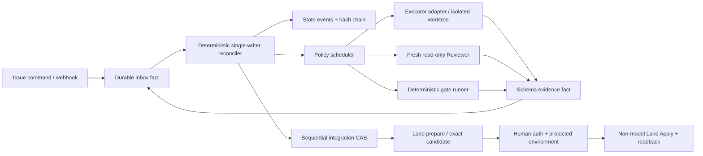

# Tự động hóa điều phối Main Orchestrator → Executor → Reviewer → Land

- **Ngày:** 2026-08-08 (Asia/Saigon)
- **Repo/head khảo sát:** `ducthangho/tra-luat` tại `f27287c9379ba6640bc14604d4ccc9afe228861a`
- **Phạm vi:** kiến trúc orchestration; không sửa protocol, workflow hay code
- **Tính chất:** non-normative; protocol/ADR/workflow đã land mới là nguồn quy tắc

## 1. Kết luận

Nên tự động hóa cao, nhưng **Main Orchestrator không nên là một phiên LLM có quyền chuyển state**. Kiến trúc phù
hợp nhất là:

> **Agent tạo code/review/evidence; một reconciler tất định, single-writer xác thực và chuyển state; GitHub giữ
> durable facts, exact-SHA checks, review và human authorization.**

Khuyến nghị trước mắt: **GitHub control plane + deterministic reconciler + provider adapters**. Temporal chỉ đáng
thêm khi có nhiều repo/mission dài ngày, human wait và SLA recovery đủ lớn để bù chi phí vận hành control plane thứ
hai. Với mặc định tối đa hai worker của protocol, triển khai Temporal ngay là quá sớm.

Codex CLI/SDK và OpenAI Agents SDK phù hợp làm worker adapter. `codex exec` chạy được trong CI, có JSONL, JSON Schema
output và sandbox rõ ràng; Agents SDK hỗ trợ structured output, evaluator loop và parallel tasks. Nhưng các primitive
này không tự đảm bảo durability, role independence hay exact Git SHA. OpenAI nói code orchestration tất định/dễ dự
đoán hơn LLM orchestration, củng cố việc giữ transition trong code:
[Codex non-interactive](https://developers.openai.com/codex/noninteractive),
[Codex SDK](https://developers.openai.com/codex/sdk),
[Agents SDK orchestration](https://openai.github.io/openai-agents-python/multi_agent/).

## 2. Mapping với protocol hiện tại

Protocol đã chọn đúng các invariant: một Executor/packet/generation, worktree riêng, effective write set không chồng
lấn, Dispatcher/Reconciler single-writer, một session một role/task, và mọi review/CI/authorization/land gắn exact
SHA. Executor không có canonical/deploy/LIVE credential; integration tuần tự; land tách deploy. Xem
[`PROTOCOL_DA_PHIEN.md`](../PROTOCOL_DA_PHIEN.md).

Roadmap đã có đúng seam: A3 state machine/reconciler shadow; A4 Executor canary; A5 Reviewer/assurance; A6
retry/successor; A7 local controller; A8 land prepare/apply. Xem
[`KE_HOACH_TRIEN_KHAI_PROTOCOL_DA_PHIEN.md`](../KE_HOACH_TRIEN_KHAI_PROTOCOL_DA_PHIEN.md).

Tại head khảo sát chưa có `.github/coordination/`: đây vẫn là thiết kế. Có thể pilot nhiều agent trong một phiên để đo
prompt/schema/cost, nhưng pilot không phải durable queue hoặc authority và không được unattended land.

## 3. Nguồn chính thức và hệ quả thiết kế

### OpenAI

- Agents SDK phân biệt manager/handoff với code orchestration; code orchestration phù hợp flow cần predictable
  speed/cost/performance. Handoff ở trong một run, không chứng minh reviewer độc lập:
  [orchestration](https://openai.github.io/openai-agents-python/multi_agent/),
  [handoffs](https://openai.github.io/openai-agents-python/handoffs/).
- `codex exec --json` phát lifecycle JSONL; `--output-schema` ép final output theo JSON Schema; mặc định read-only và
  edit cần `workspace-write`. Schema chỉ xác nhận hình dạng, không xác nhận nội dung, actor, path hay SHA:
  [non-interactive mode](https://developers.openai.com/codex/noninteractive).
- Codex SDK start/continue/resume coding thread và hướng dẫn dùng Agents SDK khi Codex là specialist trong workflow
  rộng hơn. Thread ID không nên là packet state:
  [Codex SDK](https://developers.openai.com/codex/sdk).
- Codex subagents phù hợp task độc lập/read-heavy; write-heavy cần tránh xung đột và agent nên có scope hẹp:
  [Codex subagents](https://learn.chatgpt.com/docs/agent-configuration/subagents).

### GitHub

- Webhook có thể đến sai thứ tự/chậm; receiver phải validate signature, dedupe `X-GitHub-Delivery`, ACK nhanh và có
  redelivery/repair scan:
  [troubleshooting](https://docs.github.com/en/webhooks/testing-and-troubleshooting-webhooks/troubleshooting-webhooks),
  [best practices](https://docs.github.com/en/webhooks/using-webhooks/best-practices-for-using-webhooks).
- `workflow_run` chỉ chain tối đa ba tầng; downstream có thể nhận write token/secrets và chạy artifact/code không tin
  cậy tạo privilege risk. Nó là wakeup có biên, không phải rework state machine:
  [`workflow_run`](https://docs.github.com/en/actions/reference/workflows-and-actions/events-that-trigger-workflows#workflow_run),
  [secure use](https://docs.github.com/en/actions/reference/security/secure-use).
- Actions concurrency hỗ trợ serialize/cancel và `queue: max`, nhưng ordering không được bảo đảm. Dùng làm
  backpressure/cancel SHA cũ, không làm durable queue:
  [workflow concurrency](https://docs.github.com/en/actions/how-tos/write-workflows/choose-when-workflows-run/control-workflow-concurrency).
- Required check phải pass latest commit SHA; check cũ không hợp lệ. GitHub có thể dismiss approval khi diff/merge
  base đổi và yêu cầu người khác approve push mới nhất:
  [required checks](https://docs.github.com/en/pull-requests/how-tos/merge-and-close-pull-requests/troubleshooting-required-status-checks),
  [protected branches](https://docs.github.com/en/repositories/configuring-branches-and-merges-in-your-repository/managing-protected-branches/about-protected-branches).
- Merge queue chạy check trên `merge_group` SHA khác PR head, gồm latest base và PR đứng trước; phải trigger
  `merge_group`:
  [merge queue](https://docs.github.com/en/repositories/configuring-branches-and-merges-in-your-repository/configuring-pull-request-merges/managing-a-merge-queue).
- GitHub App mặc định không có permission; nên cấp tối thiểu. Environment có required reviewer, giữ secret đến khi
  protection pass và có thể ngăn self-approval:
  [App permissions](https://docs.github.com/en/apps/creating-github-apps/registering-a-github-app/choosing-permissions-for-a-github-app),
  [review deployments](https://docs.github.com/en/actions/how-tos/deploy/configure-and-manage-deployments/review-deployments).

GitHub Agentic Workflows đang public preview, có Orchestrator/Worker pattern, scoped workers, read-only defaults và
Safe Outputs tách agent khỏi write job. Có thể thử làm hardened worker shell ở A4/A5. Không dùng nó làm authority vì
chính FAQ nói agentic workflow là lớp non-deterministic bổ sung cạnh CI/CD deterministic:
[public preview](https://github.blog/changelog/2026-06-11-github-agentic-workflows-is-now-in-public-preview/),
[OrchestratorOps](https://github.github.com/gh-aw/patterns/orchestrator-ops/),
[security architecture](https://github.github.com/gh-aw/introduction/architecture/),
[FAQ](https://github.github.com/gh-aw/reference/faq/).

### Temporal

Temporal lưu Event History, replay deterministic Workflow và resume sau failure; API/LLM/non-deterministic work phải
đặt trong Activities. Activities retry mặc định nhưng vẫn nên idempotent:
[Workflow Execution](https://docs.temporal.io/workflow-execution),
[Event History](https://docs.temporal.io/workflow-execution/event),
[Activities](https://docs.temporal.io/activities),
[Retry Policies](https://docs.temporal.io/encyclopedia/retry-policies).

Event history có giới hạn; `Continue-As-New` checkpoint sang Run ID/history mới:
[Continue-As-New](https://docs.temporal.io/workflow-execution/continue-as-new). Temporal là durable engine tốt nhưng
không thay GitHub exact-SHA review, authorization hay idempotency của push/comment/merge.

## 4. So sánh phương án

| Phương án | Durability | Role/policy | Vận hành | Kết luận |
|---|---:|---:|---:|---|
| Một Main Agent tự spawn/handoff | thấp | prompt-level | thấp | chỉ pilot |
| Chuỗi Actions `workflow_run` | trung bình thấp | phân tán | trung bình | không chọn |
| GitHub facts + deterministic reconciler | cao nếu replay/readback đúng | cao | trung bình | **chọn** |
| Temporal + GitHub projection/auth | rất cao | cao nếu tránh dual truth | cao | hướng nâng cấp |

Không chọn agent tự chain vì model vừa làm, vừa đánh giá, vừa retry/merge sẽ phá independence. Không chọn bare Actions
chain vì giới hạn ba tầng, privilege transition, event/rerun/cancel phức tạp và dễ nhầm PR head với merge SHA.

Temporal chỉ nên qua MCR/ADR khi có hàng trăm mission, nhiều repo, mission dài ngày/human wait, recovery SLA hoặc chi
phí replay/pagination GitHub rõ rệt. Khi đó phải chọn một authority: Temporal giữ state thật thì GitHub chỉ là
projection/approval surface; không âm thầm tạo hai nguồn sự thật.

## 5. Kiến trúc khuyến nghị

Ingress chỉ verify/lưu/ACK. Reconciler dedupe, order, rebuild projection, validate expected revision/generation/spec/SHA
và append transition. Scheduler áp DAG, write-set conflict, provider/role, risk, budget và worker cap. Provider adapter
không có quyền đổi state. Evidence validator coi mọi agent output là untrusted. Integrator dùng compare-and-swap trên
expected integration head. Apply job không gọi model và không sửa feature diff.

One-task-one-role phải là invariant máy kiểm: task có `task_id`, immutable `role`, `allowed_actions`,
`credential_profile`, `write_set_hash`, `expected_head`, `generation`. Mỗi Reviewer là process/session/worktree mới,
read-only. Từ chối evidence nếu session đã dùng role khác, reviewer có write/commit/push, actor/provider không đạt
assurance, lease hết hoặc generation/spec/SHA stale.

## 6. State machine và exact-SHA

```mermaid
stateDiagram-v2
  [*] --> ready
  ready --> executing: lease Executor / generation
  executing --> review_ready: evidence accepted
  executing --> ready: expiry; generation++
  review_ready --> reviewing: fresh Reviewer
  reviewing --> accepted: approve exact SHA
  reviewing --> rework: in-spec findings
  rework --> ready: content_attempt++; generation++
  reviewing --> blocked: spec/scope defect
  accepted --> admission: lock expected integration head
  admission --> review_ready: rebase/head changed
  admission --> integrated: exact reviewed/tested SHA + CAS
```

Rebase làm SHA đổi thì review/check cũ hết hiệu lực. Final admission nên khóa tuần tự, đọc integration head, rebase,
gate + review exact rebased SHA, rồi CAS merge nếu integration head không đổi; drift thì supersede/requeue. Parallelism
nằm ở execution/review packet độc lập, không ở đoạn admission/land.

Tách bốn counter:

- `generation`: fencing token; tăng khi cấp lại write authority/rework/reroute;
- `content_attempt`: tăng khi sửa nội dung do finding;
- `invocation`: mỗi provider/runner call, dùng tính quota/cost;
- `review_cycle`: một verdict cho một exact `reviewed_sha`.

Retry tự động chỉ cho transient/replay-safe. Permission/security/write-set conflict, spec defect, semantic finding và
head drift là blocking/non-retryable hoặc chuyển flow rõ ràng. Review finding tạo Executor task mới; Reviewer không
đổi role. Retry sau timeout external write phải readback trước để tránh side effect trùng.

## 7. Data model/evidence tối thiểu

| Entity | Trường cốt lõi |
|---|---|
| Mission | ID, revision, plan hash, base/head, state, budgets, policy version |
| Packet/task | packet, immutable role, generation, attempt, provider/session, write set, deps, lease, expected SHA |
| Inbox fact | delivery/command ID, payload hash, actor, timestamp, expected state revision, causation/correlation |
| Evidence | kind, subject SHA, provider/role/session, command/check IDs, result, URL/log digest, payload hash |
| Finding | source evidence, severity, acceptance clause, status, fixed-by generation |
| Authorization | exact candidate/tree, revision/spec/policy, required evidence hashes, actor, expiry |
| External effect | idempotency key, target, request hash, provider response, readback state |
| Transition | append-only old/new state, reason, actor, previous/state hash |

Executor evidence phải có task/lease/generation/attempt/invocation, provider/role/session, observed head, produced head,
changed paths/write-set hash, tested SHA, commands/exit codes/run URLs và not-run reasons. Nó chỉ có verdict
`ready_for_review|blocked`.

Reviewer evidence phải có `reviewed_sha`, independence, axes/findings/tests và verdict. Reconciler tự tính/validate
assurance; Reviewer không tự nâng tier. Khi ingest, readback current PR head; khác `reviewed_sha` thì ghi
`ReviewSuperseded`, không chuyển accepted.

Authorization bind exact candidate + tree SHA, mission revision/spec, packet generations, evidence/check IDs, policy,
actor/environment/expiry. Apply readback lại tất cả; bất kỳ drift nào đều revoke/stale và cần authorization mới.

## 8. Fail-closed, backpressure và cost

- Webhook là wakeup; schedule/manual reconciliation repair missed events.
- Unique `(provider, delivery_id)` + payload hash; transition dùng expected state revision/CAS.
- Unknown schema/action/path/actor, missing positive evidence hoặc hash-chain corruption → quarantine/pause.
- Agent output, Issue/PR text và artifacts là untrusted; không chạy PR-controlled code trong privileged
  `workflow_run`/`pull_request_target` context.
- GitHub App minimum permissions; Executor branch-only; Reviewer read-only; Apply token chỉ trong protected
  environment/OIDC. Check required nên pin expected App source.
- Tối đa hai Executor writer có disjoint effective write set; Reviewer/gate có pool read-only riêng; integration/land
  một writer.
- Inbox/backlog/budget/provider/runner/packet đều có hard limit. Đạt limit thì dừng lease mới, không drop fact.
- `cancel-in-progress` chỉ hủy compute review/gate SHA cũ; land queue serialized, không cancel giữa side effect.
- Reserve token/invocation/runner-minute trước lease; settle usage sau. Theo dõi p50/p95 lead time, cost/accepted
  packet, stale evidence, lease expiry, findings/rework, write-set collision, provider quota và integration rebase loop.

## 9. Rollout đề xuất

1. **Pilot trong phiên:** tối đa hai task, session/role riêng, Reviewer read-only; human giữ state/review/land; mọi
   evidence ghi GitHub để reconstruct không cần chat memory.
2. **A3 shadow:** pure state machine + schema/replay; inject duplicate/out-of-order/missing/edit/delete/backlog/expiry;
   zero model, zero secret, zero canonical write.
3. **A4:** một provider, một packet offline, worker 1; reconciler lease/launch/accept evidence; human review/integrate.
   Có thể thử Codex Action hoặc gh-aw Safe Outputs như worker shell, không như authority.
4. **A5:** fresh cross-provider/read-only Reviewer, exact-head supersession test; hai packet disjoint; integration human.
5. **A6:** generation/attempt/invocation/review cycle, budget reservation, circuit breaker, finding/rework/successor
   dedupe; dispatcher duy nhất tạo packet.
6. **A7:** local controller polling lease, heartbeat, hard timeout, stale-generation kill; restart recovery từ GitHub.
7. **A8:** integration CAS; rebase→exact-SHA re-review/gate; land prepare full gate; durable human auth; non-model Apply,
   canonical readback; deploy riêng.

Mỗi phase có kill switch/promotion criteria. Không bật “full autonomy” bằng một flag. Chỉ đề xuất Temporal sau khi số
liệu vận hành chứng minh cần durable engine mạnh hơn; giữ domain events/ports đủ sạch để migration không đổi semantics.
