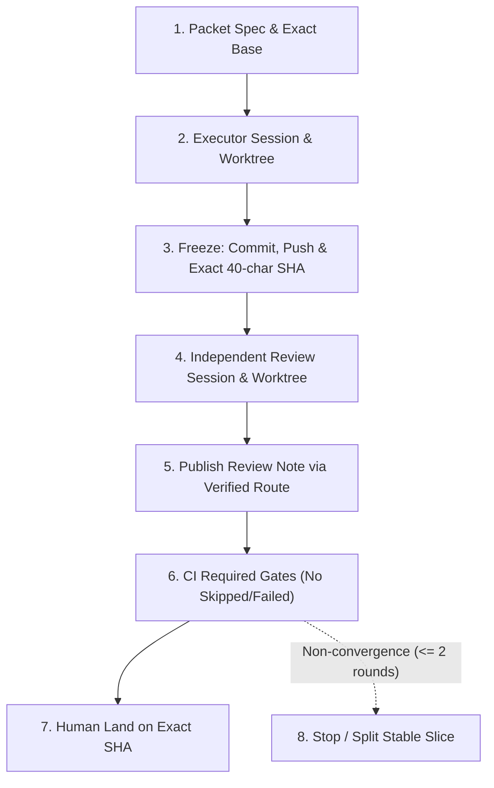

# Kế Hoạch Thi Công & Điều Phối Antigravity — tra-luat

> **Trạng thái:** Hồ sơ chuyển tiếp dành riêng cho Google Antigravity.
>
> Kế hoạch điều phối đa provider hiện hành nằm tại
> `ops/KE_HOACH_THI_CONG_DA_PROVIDER.md`.
>
> Trạng thái PR, CI, quota và review debt phải đọc từ GitHub facts;
> không coi snapshot trong file này là trạng thái có thẩm quyền.

---

## 1. Bối Cảnh & Nguyên Tắc Điều Hành

- **Tình trạng:** Claude Code và OpenAI Codex tạm thời hết quota API.
- **Quy tắc điều phối:** Sử dụng Antigravity làm **Executor** và **Reviewer dự phòng** theo cơ chế `same_provider_approved` (quy định tại `ADR-0024`, `AGENTS.md` và `docs/PROTOCOL_DA_PHIEN.md`).
- **Phân loại rủi ro chuẩn Protocol:** Áp dụng 3 tầng Review Class:
  - `routine`: same-provider independent review có thể đủ; không mặc định có review debt nếu evidence hợp lệ.
  - `systemic`: same-provider review cho phép land khi human owner chấp nhận; bắt buộc ghi nhận **1 re-audit debt** bởi Claude Code hoặc Codex khi quota phục hồi.
  - `sensitive`: cấm AG-only land; bắt buộc cross-provider hoặc human audit exact SHA trước khi land.
- **Nguyên tắc khuyết tật bằng chứng (*Evidence Defect*):** Khuyết tật bằng chứng (stale reviewed SHA, thiếu full 40-char SHA, required gate bị skip) luôn thắng Review Class và bắt buộc phát sinh review debt hoặc chặn land.

---

## 2. Danh Mục Các Packet & Trạng Thái Lịch Sử

| Seq | Packet ID | Tên Packet / Nhiệm vụ | Phạm vi Write-Set Thực Tế | Review Class | Trạng Thái Đề Xuất |
| :---: | :--- | :--- | :--- | :---: | :---: |
| 1 | `AG-T0-04` | Version generator fail-closed | `scripts/gen_instructions.py`, `RELEASE_MANIFEST.json` | `routine` | `landed_reaudit_pending` (PR #163) |
| 2 | `AG-T0-02` | Clean cross-review adapter & Root AGENTS.md | `.claude/skills/cross-review/SKILL.md`, `AGENTS.md`, `RELEASE_MANIFEST.json`, `scripts/tl_selftest.py` | `systemic` | `landed_reaudit_pending` (PR #164) |
| 3A | `AG-T0-01A` | Windows subprocess decoding policy | `.claude/dev/launcher.py`, `.claude/dev/launcher_test.py` | `systemic` | `ready_for_branch` |
| 3B | `AG-T0-01B` | Antigravity tool discovery (`agy`) | `.claude/dev/launcher.py`, `.claude/dev/launcher_test.py` | `systemic` | `planned_experimental` |
| 3C | `AG-T0-01C` | Antigravity plan & Lean AGENTS pointer | `AGENTS.md`, `ops/KE_HOACH_THI_CONG_ANTIGRAVITY.md` | `systemic` | `ready_for_branch` |
| 4 | `AG-T0-03` | Argparse parser-tree coverage report | `scripts/tl_core/command_registry.py`, `scripts/tl_core/workflow.py`, `scripts/test_fragments/<packet>.py` | `systemic` | `planned` (depends on baseline remeasure) |
| 5 | `AG-T0-05` | Registry ratchet & generated golden projection | `scripts/tl_core/command_registry.py`, `scripts/tl_core/workflow.py`, `scripts/test_fragments/<packet>.py`, `references/golden/parser_surface.json` | `systemic` | `planned` (depends on `AG-T0-03`) |

---

## 3. Quản Lý Nợ Review (Review Debt Policy)

Hàm tính nợ review chính thức:

$$\text{Review Debt} = f(\text{Review Class}, \text{Assurance Level}, \text{Exact SHA Validity}, \text{Identity Evidence}, \text{Gate Status}, \text{Head Staleness})$$

### Hồ sơ nợ review hiện tại:
1. **Packet 1 (`AG-T0-04` — PR #163):**
   - Trạng thái: `landed_reaudit_pending`
   - Lý do: `reviewed_sha` ban đầu (`125f8f0`) là SHA rút gọn và bị stale so với merge head cuối (`2995f7c...`). Cần 1 lượt re-audit đối chiếu base `6d17c1b...` tới merge commit `131ec17...` khi Claude/Codex hồi phục quota.
2. **Packet 2 (`AG-T0-02` — PR #164):**
   - Trạng thái: `landed_reaudit_pending`
   - Lý do: Thay đổi `systemic` vào review orchestration và entrypoint root `AGENTS.md`; `reviewed_sha` dùng SHA rút gọn (`fe99d00`); chưa có machine-validated reviewer identity receipt. Cần 1 lượt re-audit bởi Claude hoặc Codex.
3. **PR #165 cũ (Đã Đóng):**
   - Trạng thái: `closed_blocked_ci`
   - Lý do: Gộp 3 concerns khác nhau; gate release-verify fail do lệch băm gói khi sửa `AGENTS.md` chưa đồng bộ manifest; required Windows launcher gate bị skip.

---

## 4. Quy Trình Thi Công & Hợp Đồng Thẩm Định Chuẩn (8 Bước)

Mọi Packet tiếp theo do Antigravity thực hiện phải tuân thủ nghiêm ngặt quy trình:



1. **Authority:** Human/dispatcher xác lập Packet Spec bền vững (mục tiêu, exact base SHA, write-set, review class, acceptance criteria).
2. **Executor:** AG session A trên worktree A độc lập; chỉ ghi trong effective write-set.
3. **Freeze:** Commit, push, ghi nhận exact 40-character hexadecimal Git OID và tree hash.
4. **Independent Reviewer:** AG session B trên checkout/worktree B độc lập (không fork conversation context từ Executor, repository read-only, cho phép scratch ngoài repository để mutation test); verdict bắt buộc neo exact 40-character Git OID.
5. **Publishing & Readback:** Đăng PR và review note qua GitHub route đã chứng minh; đọc ngược để đối soát byte/hash.
6. **CI Gate Verification:** Tất cả required checks chạy trên exact head; required check bị skipped hoặc failed $\rightarrow$ **BLOCKED**.
7. **Human Land:** Human Approver duyệt và land exact SHA; head đổi $\rightarrow$ toàn bộ review và CI cũ bị vô hiệu (stale).
8. **Non-Convergence Stop:** Tối đa 2 vòng review AG cho cùng một PR. Sau 2 vòng chưa đạt approve $\rightarrow$ dừng phiên, tách Stable Slice hoặc revision Packet Spec.

---

## 5. Cấu Trúc Review Note Chuẩn (`format: temporary_ag_review_note.v0`)

Trong giai đoạn receipt schema đang hoàn thiện, các review note của AG bắt buộc sử dụng định dạng minh bạch:

```yaml
format: temporary_ag_review_note.v0
machine_validated: false
reviewed_sha: "40_CHARACTER_HEX_GIT_OID"
reviewed_target: "Packet ID & Name"
reviewer_provider: google_antigravity
reviewer_model: "<runtime_reported_model>"
reviewer_session_id: "<session_uuid>"
reviewer_worktree_path: "<isolated_worktree_path>"
executor_session_id: "<different_executor_session_uuid>"
github_submitter: "<github_actor_login>"
verdict: "approve" # approve | changes_requested | blocked
findings: []
test_evidence:
  gate_name: "PASS / FAIL (positive output marker)"
limitations:
  - "same-provider review (isolated Antigravity reviewer session)"
  - "<review_debt_declaration>"
assurance: same_provider_approved
```

---

## 6. Tiêu Chuẩn Cho Các Packet Tiếp Theo

### Packet 3A (`AG-T0-01A` — Windows Subprocess Decoding Policy)
- **Write-Set:** `.claude/dev/launcher.py`, `.claude/dev/launcher_test.py`
- **Yêu cầu kỹ thuật:** Xây dựng helper decode tách bạch:
  - `_run_text_human(...)`: cho phép `errors="replace"` đối với log/hiển thị cho con người.
  - `_run_json_strict(...)`: bắt buộc decode strict hoặc trả lỗi cấu trúc đối với JSON / machine-readable output.
- **Tiêu chí nghiệm thu:** Fixture phát byte ngoài cp1258/cp1252; không còn lỗi `UnicodeDecodeError` trong `_readerthread`; luồng CI `launcher (Windows that)` chạy thực tế và có bằng chứng dương.

### Packet 3C (`AG-T0-01C` — Antigravity Plan & Lean AGENTS Pointer)
- **Write-Set:** `AGENTS.md`, `ops/KE_HOACH_THI_CONG_ANTIGRAVITY.md`
- **Yêu cầu kỹ thuật:** Đồng bộ bản `AGENTS.md` tinh gọn (lean pointer) và kế hoạch thi công bán tĩnh vào repo, chạy `doc-claims-check` và `release-verify` sạch 100%.

### Packet 4 (`AG-T0-03` — Argparse Parser-Tree Coverage Report)
- **Write-Set:** `scripts/tl_core/command_registry.py`, `scripts/tl_core/workflow.py`, `scripts/test_fragments/<packet>.py`
- **Yêu cầu kỹ thuật:** Báo cáo read-only (`--coverage-report`), đệ quy duyệt nested subparsers, sort tất định, không làm đỏ CI trên gap lịch sử; đo lại baseline trên `master` sạch trước khi thi công.

### Packet 5 (`AG-T0-05` — Registry Ratchet & Generated Golden Projection)
- **Write-Set:** `scripts/tl_core/command_registry.py`, `scripts/tl_core/workflow.py`, `scripts/test_fragments/<packet>.py`, `references/golden/parser_surface.json`
- **Yêu cầu kỹ thuật:** Phải đi đúng chiều: Parser tree $\rightarrow$ Command metadata $\rightarrow$ Validator $\rightarrow$ Generated golden $\rightarrow$ Golden verification. Tuyệt đối không coi golden là authority để ép ngược code.
