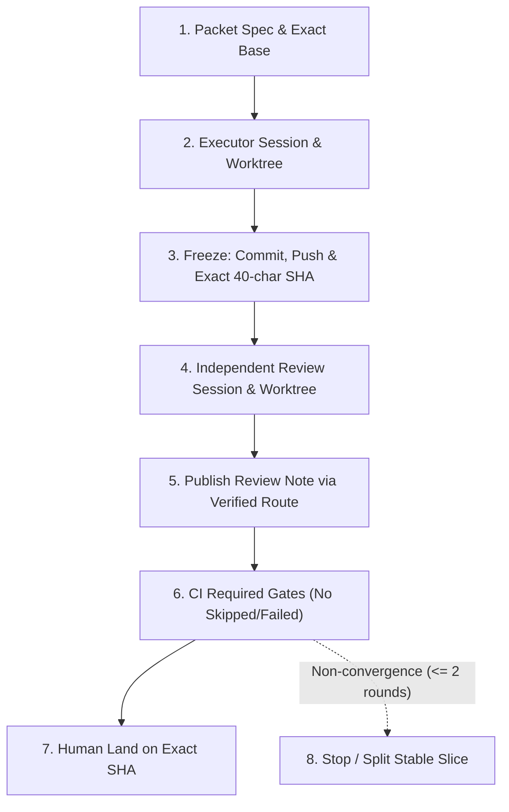

# Kế Hoạch Thi Công & Điều Phối Antigravity — tra-luat

> **Trạng thái:** Hồ sơ chuyển tiếp dành riêng cho Google Antigravity.
>
> Kế hoạch điều phối đa provider hiện hành nằm tại
> `ops/KE_HOACH_THI_CONG_DA_PROVIDER.md`.
>
> Trạng thái PR, CI, quota và review debt phải đọc từ GitHub facts;
> không coi snapshot trong file này là trạng thái có thẩm quyền.

---

## 1. Bối Cảnh & Nguyên Tắc Điều Hành

- **Tình trạng:** Claude Code và OpenAI Codex tạm thời hết quota API.
- **Quy tắc điều phối:** Sử dụng Antigravity làm **Executor** và **Reviewer dự phòng** theo cơ chế `same_provider_approved` (quy định tại `ADR-0024`, `AGENTS.md` và `docs/PROTOCOL_DA_PHIEN.md`).
- **Phân loại rủi ro chuẩn Protocol:** Áp dụng 3 tầng Review Class:
  - `routine`: same-provider independent review có thể đủ; không mặc định có review debt nếu evidence hợp lệ.
  - `systemic`: same-provider review cho phép land khi human owner chấp nhận; bắt buộc ghi nhận **1 re-audit debt** bởi Claude Code hoặc Codex khi quota phục hồi.
  - `sensitive`: cấm AG-only land; bắt buộc cross-provider hoặc human audit exact SHA trước khi land.
- **Nguyên tắc khuyết tật bằng chứng (*Evidence Defect*):** Khuyết tật bằng chứng (stale reviewed SHA, thiếu full 40-char SHA, required gate bị skip) luôn thắng Review Class và bắt buộc phát sinh review debt hoặc chặn land.

---

## 2. Danh Mục Các Packet

> **CỘT TRẠNG THÁI ĐÃ BỊ BỎ — có lý do đo được.** Bản trước của bảng này có cột
> *Trạng Thái Đề Xuất*, và tới 19-08-2026 nó **sai 3/7 dòng**: `AG-T0-01A`, `AG-T0-01C`
> và `AG-T0-03` đều đã land nhưng bảng vẫn ghi `ready_for_branch` / `planned`. Nguyên
> nhân kép: packet land dưới **tên khác** tên trong bảng (`Packet 1` = `AG-T0-04`,
> `Packet 2` = `AG-T0-02`, `Packet 3C` = `AG-T0-01C`), và trạng thái là **dữ liệu động**
> mà `ops/KE_HOACH_THI_CONG_DA_PROVIDER.md` §12 đã cấm lưu trong tài liệu tĩnh.
>
> Sửa tay cột ấy chỉ đẩy sai lệch sang lần sau. **Đọc trạng thái từ GitHub facts.**

| Packet ID | Tên Packet / Nhiệm vụ | Phạm vi Write-Set Thực Tế | Review Class |
| :--- | :--- | :--- | :---: |
| `AG-T0-04` | Version generator fail-closed *(land dưới tên `Packet 1`)* | `scripts/gen_instructions.py`, `RELEASE_MANIFEST.json` | `routine` |
| `AG-T0-02` | Clean cross-review adapter & Root AGENTS.md *(land dưới tên `Packet 2`)* | `.claude/skills/cross-review/SKILL.md`, `AGENTS.md`, `RELEASE_MANIFEST.json`, `scripts/tl_selftest.py` | `systemic` |
| `AG-T0-01A` | Windows subprocess decoding policy | `.claude/dev/launcher.py`, `.claude/dev/launcher_test.py` | **`sensitive`** ² |
| `AG-T0-01B` | Antigravity tool discovery (`agy`) — Issue `#219` | `.claude/dev/launcher.py`, `.claude/dev/launcher_test.py` | **`sensitive`** ² |
| `AG-T0-01C` | Antigravity plan & Lean AGENTS pointer *(land dưới tên `Packet 3C`)* | `AGENTS.md`, `ops/KE_HOACH_THI_CONG_ANTIGRAVITY.md` | `systemic` |
| `AG-T0-03` | Argparse parser-tree coverage report | `scripts/tl_core/command_registry.py`, `scripts/tl_core/workflow.py`, + **derived set** | `systemic` |
| `AG-T0-05` | Registry ratchet & generated golden projection | `scripts/tl_core/command_registry.py`, `scripts/tl_core/workflow.py`, `references/golden/parser_surface.json` | `systemic` |

² **`review_class` của hai dòng `launcher` đã được SỬA `systemic` → `sensitive`** (21-08-2026).

`docs/PROTOCOL_DA_PHIEN.md:572-573` liệt kê **`launcher`** đích danh trong `sensitive`. Lời khai
`systemic` cũ phân loại theo thứ packet KHÔNG đụng thay vì thứ nó CÓ đụng — **theo VỊ TRÍ thay vì
theo HẬU QUẢ**, đúng hình dạng đã bị đính chính ở `PLAT-M4`
(`ops/DINH_CHINH_REVIEW_CLASS_PLAT_M4.md`). `:568-569`: *"Executor không được hạ lớp."*

Cột này **không phải trạng thái động** nên nó thuộc về đây, khác hẳn cột *Trạng Thái Đề Xuất* đã bị
bỏ: `review_class` suy ra từ **đường dẫn bị chạm**, không đổi theo PR/CI/quota. Sai ở đây là sai
HỢP ĐỒNG, không phải sai ảnh chụp.

Hệ quả cứng cho `AG-T0-01B`: **cấm AG–AG land**; và vì `agy models` (đo 21-08-2026) liệt kê cả
`claude-sonnet-4-6` lẫn `gpt-oss-120b-medium`, chọn reviewer theo TÊN CÔNG CỤ là chưa đủ — xem
§6 mục `AG-T0-01B` và Issue `#220` (`PLAT-X7`).

`AG-T0-01A` **đã land** dưới lời khai cũ. Sửa ở đây là ghi cho đúng lớp, **không hồi tố** mức
assurance của lần land ấy — muốn hồi tố thì phải qua re-audit, và nó chưa có.

**Năm dòng còn lại CHƯA được đối chiếu lại với `docs/PROTOCOL_DA_PHIEN.md` §8.** Không im lặng nâng
lớp cho chúng ở đây: nâng mà không đo là đổi một lời khai chưa kiểm lấy một lời khai chưa kiểm
khác. `:569` đòi fail-closed (*"Path không biết, classifier lỗi hoặc bằng chứng không đọc được đều thành `sensitive`"*), nên khi có ai đụng lại một trong
năm dòng ấy thì phải phân loại lại TRƯỚC, đừng đọc bảng này làm đã-đúng.

**WRITE SET và DERIVED SET là hai thứ khác nhau** — bài học đo được từ `AG-T0-03`: packet
khai 3 tệp, thực tế đụng 10. Sáu tệp chênh lệch là **tái sinh cơ học bắt buộc**
(`RELEASE_MANIFEST.json`, `references/golden/*.json`) khi thêm một lệnh, **không phải vi
phạm phạm vi**. Packet Spec phải khai hai tập riêng, nếu không cổng phạm vi sẽ báo vi phạm
giả ở mọi packet có thêm lệnh.

## 3. Quản Lý Nợ Review (Review Debt Policy)

Hàm tính nợ review chính thức:

$$\text{Review Debt} = f(\text{Review Class}, \text{Assurance Level}, \text{Exact SHA Validity}, \text{Identity Evidence}, \text{Gate Status}, \text{Head Staleness})$$

### Sổ nợ — TĨNH, và vì sao nó có hình dạng này

Bản trước của mục này ghi mỗi khoản một dòng `Trạng thái: landed_reaudit_pending` /
`closed_blocked_ci`. Đó là **trạng thái động viết tay** — `ops/KE_HOACH_THI_CONG_DA_PROVIDER.md`
§12 cấm đúng thứ ấy (*"Packet đã merge hay chưa"*), và nó là cùng cái bẫy đã làm cột *Trạng Thái
Đề Xuất* ở §2 sai 3/7 dòng. Nội dung khi ấy tình cờ vẫn đúng; cái sai là **hình dạng**, và hình
dạng ấy sai âm thầm cho tới lượt cập nhật nào đó bị bỏ quên.

Một khoản nợ tách được làm hai phần, và **cả hai đều tĩnh**:

- **Sự việc** — neo bằng SHA đầy đủ, bất biến, không đổi theo thời gian;
- **Điều kiện đóng** — một phép đo trả lời có/không.

Thứ động là *"đã đóng chưa"*, và câu trả lời đo bằng **sự tồn tại của biên nhận** trong
`ops/reviews/`, không bằng một nhãn viết tay ở đây.

| # | sự việc (bất biến) | điều kiện đóng (phép đo) |
| :-- | :--- | :--- |
| N1 | `AG-T0-04` — PR `#163`, hai commit `bea68ed92b0bdf29dfec8d5f3ff1b8165d80e8ac` và `2995f7cde727ecddcc4353e713caf866ee7d02b5`, merge `131ec17e6c7114f29cf2e18dda34bd85266923b4`, base `6d17c1b43d997edb50959b1a65f9a70ece46f27a` | tồn tại một biên nhận `ops/reviews/ag-t0-04-reaudit-*-verdict.receipt.yaml` neo `reviewed_sha` = `131ec17e…` (40 ký tự) |
| N2 | `AG-T0-02` — PR `#164`, head `fe99d00b3d882009b2043b8309328e16946af3bb`; đổi `.claude/skills/cross-review/SKILL.md` (review orchestration) và `AGENTS.md` | tồn tại `ops/reviews/ag-t0-02-reaudit-*-verdict.receipt.yaml` neo `reviewed_sha` = `fe99d00b…` **và** khai `model_reviewer_identity` đủ `provider/model/session` |
| N3 | PR `#165` — gộp 3 mối quan tâm; `release-verify` đỏ vì sửa `AGENTS.md` mà không đồng bộ manifest; gate Windows bị `skip` | **KHÔNG phải nợ.** PR đóng, không merge, không mã nào vào `master`. Giữ ở đây làm **hình dạng lỗi kế thừa** cho packet sau — xem `ops/specs/ag-t0-01b-r3.md` §8 |

**Đo 21-08-2026, và nó tự minh hoạ cho chính chính sách này:** bản trước ghi `reviewed_sha` ban đầu
của N1 là `125f8f0`. Chuỗi đó **không phân giải được** — `git cat-file -e 125f8f0^{commit}` trả
*"Not a valid object name"*, và nó không nằm trên chuỗi commit của PR `#163` (`bea68ed9` →
`2995f7cd`). Nhánh gốc đã bị xoá hoặc ép lùi, nên một SHA rút gọn 7 ký tự viết trong tài liệu nay
trỏ vào **hư không**.

Đó chính là *khuyết tật bằng chứng* mà §1 nói tới, minh hoạ bằng chính sổ nợ này: **SHA rút gọn
không phải bằng chứng yếu — nó là bằng chứng có hạn sử dụng.** Vì vậy re-audit của N1 **không thể
"đối chiếu lại"** với `125f8f0`; nó phải là một lượt audit MỚI trên khoảng
`6d17c1b4…131ec17e`, và mọi SHA trong bảng trên đều ghi đủ 40 ký tự.

**Trạng thái hiện thời của từng khoản đọc từ GitHub facts và `ops/reviews/`, không đọc ở đây.**

---

## 4. Quy Trình Thi Công & Hợp Đồng Thẩm Định Chuẩn (8 Bước)

Mọi Packet tiếp theo do Antigravity thực hiện phải tuân thủ nghiêm ngặt quy trình:



1. **Authority:** Human/dispatcher xác lập Packet Spec bền vững (mục tiêu, exact base SHA, write-set, review class, acceptance criteria).
2. **Executor:** AG session A trên worktree A độc lập; chỉ ghi trong effective write-set.
3. **Freeze:** Commit, push, ghi nhận exact 40-character hexadecimal Git OID và tree hash.
4. **Independent Reviewer:** AG session B trên checkout/worktree B độc lập (không fork conversation context từ Executor, repository read-only, cho phép scratch ngoài repository để mutation test); verdict bắt buộc neo exact 40-character Git OID, và **mỗi finding bắt buộc kèm khối `Gợi ý vá` bốn phần** theo `ops/KE_HOACH_THI_CONG_DA_PROVIDER.md` §10c.
5. **Publishing & Readback:** Đăng PR và review note qua GitHub route đã chứng minh; đọc ngược để đối soát byte/hash.
6. **CI Gate Verification:** Tất cả required checks chạy trên exact head; required check bị skipped hoặc failed $\rightarrow$ **BLOCKED**.
7. **Human Land:** Human Approver duyệt và land exact SHA; **head của NHÁNH** đổi $\rightarrow$ toàn bộ review và CI cũ bị vô hiệu (stale). **MASTER drift KHÔNG phải head nhánh đổi** — trường hợp đó merge thẳng, không chạy lại CI, theo `ops/KE_HOACH_THI_CONG_DA_PROVIDER.md` §10b (kèm danh sách 6 kích hoạt bắt buộc chạy lại).
8. **Non-Convergence Stop:** Tối đa 2 vòng review cho cùng một PR — **không riêng AG**, đây là trần canon của cả kho (`ops/KE_HOACH_THI_CONG_DA_PROVIDER.md` §10). Đếm theo `review_rounds_used`, KHÔNG theo `codex_review_calls_used` (một vòng có thể tốn nhiều lời gọi). Sau 2 vòng chưa đạt approve $\rightarrow$ dừng phiên, tách Stable Slice hoặc revision Packet Spec. Lưu ý: trần này hiện CHƯA được cưỡng chế bằng mã — xem nợ ở §10 của tài liệu canon.

---

## 5. Cấu Trúc Review Note Chuẩn (`format: temporary_ag_review_note.v0`)

Trong giai đoạn receipt schema đang hoàn thiện, các review note của AG bắt buộc sử dụng định dạng minh bạch:

```yaml
format: temporary_ag_review_note.v0
machine_validated: false
reviewed_sha: "40_CHARACTER_HEX_GIT_OID"
reviewed_target: "Packet ID & Name"
reviewer_provider: google_antigravity
reviewer_model: "<runtime_reported_model>"
reviewer_session_id: "<session_uuid>"
reviewer_worktree_path: "<isolated_worktree_path>"
executor_session_id: "<different_executor_session_uuid>"
github_submitter: "<github_actor_login>"
verdict: "approve" # approve | changes_requested | blocked
findings: []   # mỗi finding BẮT BUỘC kèm `recommendation` chứa 4 phần của §10c
               # (vá ở đâu · vá thế nào · ca test khoá nó · bản vá đẻ ra gì)
test_evidence:
  gate_name: "PASS / FAIL (positive output marker)"
limitations:
  - "same-provider review (isolated Antigravity reviewer session)"
  - "<review_debt_declaration>"
assurance: same_provider_approved
```

---

## 6. Tiêu Chuẩn Kỹ Thuật Từng Packet

> Tiêu đề cũ là *"…Cho Các Packet Tiếp Theo"*. Sai từ lúc `AG-T0-01A`, `AG-T0-01C`, `AG-T0-03`
> và `AG-T0-05` land: bốn trong năm mục dưới đây là **hồ sơ**, không phải việc sắp tới. Mục duy
> nhất còn là việc là `AG-T0-01B`. Trạng thái từng packet vẫn đọc từ GitHub facts — mục này chỉ
> giữ **yêu cầu kỹ thuật**, thứ không đổi theo PR/CI.

### Packet 3A (`AG-T0-01A` — Windows Subprocess Decoding Policy)
- **Write-Set:** `.claude/dev/launcher.py`, `.claude/dev/launcher_test.py`
- **Yêu cầu kỹ thuật:** Xây dựng helper decode tách bạch:
  - `_run_text_human(...)`: cho phép `errors="replace"` đối với log/hiển thị cho con người.
  - `_run_json_strict(...)`: bắt buộc decode strict hoặc trả lỗi cấu trúc đối với JSON / machine-readable output.
- **Tiêu chí nghiệm thu:** Fixture phát byte ngoài cp1258/cp1252; không còn lỗi `UnicodeDecodeError` trong `_readerthread`; luồng CI `launcher (Windows that)` chạy thực tế và có bằng chứng dương.

### Packet 3B (`AG-T0-01B` — Antigravity CLI `agy` discovery) — Issue `#219`

- **Write-Set:** `.claude/dev/launcher.py`, `.claude/dev/launcher_test.py`. `derived_set` **RỖNG**
  (`.claude` thuộc `_RELEASE_EXCLUDE_DIRS`; `grep launcher RELEASE_MANIFEST.json` = 0).
- **Đặc tả đóng băng:** `ops/specs/ag-t0-01b-r3.md`, sha256
  `25da97c724bc47dfa73012e9f2c460037ca4d873bb60ce49be46a444bbe61a37`. `r1`/`r2` giữ làm lịch sử,
  **không** có hiệu lực. Mục này KHÔNG chép lại mục tiêu/nghiệm thu của đặc tả — chép là tạo hai
  bản sẽ trôi lệch.
- **Sự thật đo được về `agy`** (21-08-2026, `agy 1.1.17`, Linux chưa đăng nhập **và** Windows đã
  đăng nhập — hai nền, hai trạng thái xác thực):

  | lệnh | rc | ghi chú |
  |---|---|---|
  | `agy --version` | 0 | in `1.1.17`; **không** mở luồng đăng nhập khi chưa login |
  | `agy --help` | 0 | ghi ra **stderr**, stdout **0 byte**; lộ 10 lệnh con |
  | `agy models` | 1 → 0 | chưa login `rc=1` + câu từ chối · đã login `rc=0` + 14 dòng model |
  | `agy agents` | 0 | **cả hai luồng RỖNG** trên CẢ HAI nền |

- **Ba điều cấm, mỗi điều có phép đo đứng sau:** `agy` **trần** mở TUI ⇒ probe gọi trần sẽ treo ·
  probe đọc **cả hai luồng**, đọc mỗi stdout là kết luận sai · **không** phân loại bằng dò chuỗi
  (trình cài in log THÀNH CÔNG ra stderr với tiền tố `ERROR:`).
- **`agy agents` là fixture "kẻ nói dối"**, không phải probe: `rc=0` + hai luồng rỗng, giống hệt
  nhau trên hai nền ⇒ đó là hành vi của công cụ, không phải tật của một nền.
- **Xác thực đi bằng `agy models`**, không bằng `agy -p`: không tương tác, không tốn quota, và
  **kiểm chứng được** (gọi thật ra dịch vụ). Tài liệu cài đặt của Google **không** liệt kê lệnh
  này — chỉ `agy --help` mới lộ; bản đặc tả đầu suy từ tài liệu và đã ra thiết kế ngược lại.
- **Windows là bắt buộc, và nhãn KHÔNG đủ:** `ci.yml` khai `pull_request:` không kèm `types:` nên
  `labeled` không sinh lượt chạy nào. Đường chắc chắn là `workflow_dispatch` trên exact ref.
- **Ràng buộc reviewer:** `sensitive` + `agy` nạp được model của nhà khác ⇒ lease phải khai `model`
  của phiên AG và verdict khai `model_reviewer_identity` đủ `provider/model/session`. Cưỡng chế
  bằng cổng là packet riêng — `PLAT-X7`, Issue `#220`.

### Packet 3C (`AG-T0-01C` — Antigravity Plan & Lean AGENTS Pointer)
- **Write-Set:** `AGENTS.md`, `ops/KE_HOACH_THI_CONG_ANTIGRAVITY.md`
- **Tệp này ĐÃ BỊ CHẠM ngoài packet, 22-08-2026:** hai dòng (`:59`, `:216`) đổi `PLAT-X6` → `PLAT-X7` sau khi Issue `#220` đổi định danh. Chỉ sửa TÊN packet, số Issue giữ nguyên; không dòng nào khác đổi. Ghi ở đây vì `AG-T0-01C` khai tệp này trong Write-Set và chưa có lease — nên nó KHÔNG phải người đầu tiên chạm tệp.
- **Yêu cầu kỹ thuật:** Đồng bộ bản `AGENTS.md` tinh gọn (lean pointer) và kế hoạch thi công bán tĩnh vào repo, chạy `doc-claims-check` và `release-verify` sạch 100%.

### Packet 4 (`AG-T0-03` — Argparse Parser-Tree Coverage Report)
- **Write-Set:** `scripts/tl_core/command_registry.py`, `scripts/tl_core/workflow.py`, `scripts/test_fragments/<packet>.py`
- **Yêu cầu kỹ thuật:** Báo cáo read-only (`--coverage-report`), đệ quy duyệt nested subparsers, sort tất định, không làm đỏ CI trên gap lịch sử; đo lại baseline trên `master` sạch trước khi thi công.

### Packet 5 (`AG-T0-05` — Registry Ratchet & Generated Golden Projection)
- **Write-Set:** `scripts/tl_core/command_registry.py`, `scripts/tl_core/workflow.py`, `scripts/test_fragments/<packet>.py`, `references/golden/parser_surface.json`
- **Yêu cầu kỹ thuật:** Phải đi đúng chiều: Parser tree $\rightarrow$ Command metadata $\rightarrow$ Validator $\rightarrow$ Generated golden $\rightarrow$ Golden verification. Tuyệt đối không coi golden là authority để ép ngược code.
