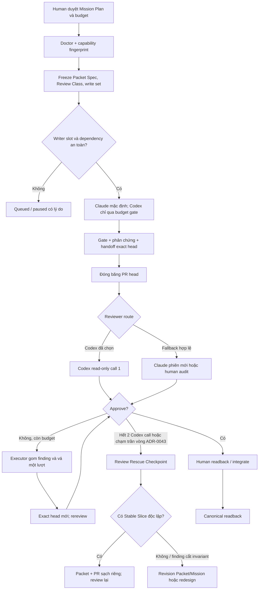

# Execution dossier — Claude Executor, Codex code/review theo ngân sách

- **Trạng thái:** kế hoạch đã được chủ kho chốt, thẩm định chung Claude–Codex 5 vòng và duyệt
  bundle A–G cùng D1/D2; chưa triển khai runtime
- **Base lúc lập:** `1a6aedf6b92ff271bf07a8b9deee2f83d430ed49`
- **Worktree kế hoạch:** `work/orchestrator-process-plan`
- **Không thuộc lượt này:** implement runtime, tạo Issue/PR, commit, push, cài công cụ, bật App/check
  hoặc đổi branch rule; model chỉ được gọi read-only để thẩm định kế hoạch

Tệp này là hồ sơ vận hành mỏng. Quy tắc chuẩn nằm duy nhất ở
[`docs/PROTOCOL_DA_PHIEN.md`](../docs/PROTOCOL_DA_PHIEN.md); roadmap và acceptance tổng nằm ở
[`docs/KE_HOACH_TRIEN_KHAI_PROTOCOL_DA_PHIEN.md`](../docs/KE_HOACH_TRIEN_KHAI_PROTOCOL_DA_PHIEN.md).
Nếu câu chữ ở đây lệch protocol thì protocol thắng. Tiền tố `planned:` nghĩa là đích dự kiến, không khẳng định
tệp/capability đã có.

## 1. Phương án được chọn

Giữ kiến trúc hiện có và thêm một lớp **Thin Orchestration**:

- `launcher.py` neo repo/root commit/HEAD/ref/prompt/deadline và quản lý cây tiến trình;
- `packet_loop.py` giữ state, attempt, stable finding ID và stop condition;
- ba skill hiện có tiếp tục là adapter mỏng;
- GitHub Issue/PR là nơi phối hợp bền; route GitHub được chọn theo capability mà `doctor` đo được;
- Claude Code `opus`, effort `max` là Executor mặc định;
- Codex vừa là Reviewer hiếm, vừa có thể làm Executor nhỏ trong ceiling 30%; không tự review code mình;
- land và activation authority vẫn do human cho tới khi có bằng chứng promote.

Những ý hay đã lấy từ nghiên cứu orchestrator ngoài được chuyển thành capability nhỏ, không cài nguyên dự án:

| Mẫu học được | Cách nhập vào kho |
|---|---|
| Dual-model specialization | Claude làm Executor chính; Codex soi exact-head ở Packet đáng giá/rủi ro cao |
| Multi-lens review | Verdict có hai trục Spec và Standards/Security, stable finding IDs và schema tất định |
| Plan/design gate | Packet chỉ ready sau spec hash, dependency, effective write set và Review Class |
| Bounded auto-fix | Reviewer không sửa branch; Executor gom findings thành đúng một lượt vá trước rereview |
| Phase gate/specialist role | M1 evidence → M2 execution/shadow → M3 authority; vai trò tách bằng session/worktree |
| Review rescue | Hết budget thì tách Stable Slice sạch hoặc revision thiết kế, không gọi model theo quán tính |

## 2. Hồ sơ quyết định

| Quyết định | Nguồn |
|---|---|
| Claude Executor chính; Codex review tối đa hai call/PR | [ADR-0036](../docs/adr/0036-claude-executor-codex-review-theo-rui-ro.md) |
| Review Rescue và tách Stable/Remediation Slice | [ADR-0037](../docs/adr/0037-review-rescue-va-tach-stable-slice.md) |
| `routine/systemic/sensitive`, unknown fail-closed | [ADR-0038](../docs/adr/0038-review-class-fail-closed.md) |
| Thin Orchestration; ba Mission trước auto-dispatch proposal | [ADR-0039](../docs/adr/0039-thin-orchestration-va-nguong-promote.md) |
| Tách model reviewer khỏi GitHub submitter | [ADR-0040](../docs/adr/0040-tach-model-reviewer-va-github-submitter.md) |
| Claude ≥70%, Codex Executor ≤30% ngân sách | [ADR-0041](../docs/adr/0041-ngan-sach-executor-claude-70-codex-30.md) |
| Deadline wall-clock 90/90 và working-state evidence | [ADR-0042](../docs/adr/0042-deadline-wall-clock-va-working-state-evidence.md) |

## 3. Vân tay môi trường và nguyên tắc bootstrap

Phép đo lúc lập kế hoạch trong worktree này:

- Claude Code `2.1.233`; CLI có `--model opus --effort max`;
- Codex CLI `0.146.0` có mặt; lượt `doctor` hiện tại chưa live-prove được Codex trong môi trường này;
- GitHub capability chưa được chứng minh cho mọi route; container/remote ưu tiên MCP GitHub + git;
- PyYAML tùy chọn chưa có;
- `doctor --json` đã phát stdout JSON nhưng reader thread Windows ném `UnicodeDecodeError` ở `cp1258`; đây là
  capability debt W0-M2, không được đọc rc=0 thành output machine-readable hoàn toàn sạch;
- bản đầu không gọi model live; phiên sau chỉ gọi Claude Opus/max read-only để thẩm định 5 vòng,
  không dùng Codex CLI review budget.

Thẩm định sau đó cho thấy cùng một kho có hai fingerprint hợp lệ: sandbox này không probe được Codex,
trong khi host gọi thẳng candidate `codex.CMD login status` thì đã đăng nhập; GitHub/PyYAML cũng khác theo
môi trường. `doctor` hiện còn tìm candidate path nhưng có đường probe gọi tên trần và không thử candidate
kế sau một lỗi. Vì vậy mỗi fingerprint phải giữ `actor/environment/time` và danh sách candidate+error;
không fingerprint nào được ghi đè thành kết luận chung về kho.

Đây là thuộc tính môi trường, không phải thuộc tính vĩnh viễn của kho. Mỗi Mission bắt đầu bằng:

```powershell
python .claude/dev/launcher.py doctor --json
python .claude/dev/launcher.py moi-truong --json
python .claude/dev/packet_loop.py doctrine-scan --root .
```

Không tự cài thứ còn thiếu. Chỉ dùng `doctor --kiem-song` khi Mission budget cho phép một lời gọi thật và người giữ
đã duyệt. Ở remote/container, nếu MCP GitHub khỏe thì dùng MCP + git; không cài `gh` để ép một route khác và không
dùng `curl` tới endpoint MCP. Nếu cần client JSON-RPC của kho, dùng `urllib` với endpoint đã cấu hình và không in
`GITHUB_PAT`. Không có route GitHub được chứng minh thì pause ở bước publish, không biến file local thành bằng
chứng đã đăng.

## 4. Vai trò, ngân sách và hàng đợi

### 4.1 Phân vai

| Vai trò | Mặc định | Quyền |
|---|---|---|
| Executor chính | Claude Code `opus`, effort `max` | Ghi đúng worktree/write-set Packet; không review/approve/land code mình |
| Executor phụ | Codex, tối đa 30% executor budget | Chỉ Packet `routine/systemic` nhỏ, đóng, độc lập; cần Claude/human review |
| Reviewer ưu tiên | Codex | Read-only exact PR head; tối đa hai call/PR |
| Reviewer fallback | Claude phiên mới hoặc human | Đúng assurance thực; phạm vi `sensitive` không hạ xuống same-provider một mình |
| Approver/Land authority | Human | Chọn slice, revision thiết kế, land và activation authority |

### 4.2 Cách tính 70/30

Mission Plan khai trước các trường sau; reviewer budget đứng ngoài executor denominator và được reserve trước:

```yaml
executor_budget:
  unit: estimated_tokens
  claude_reserved: <integer>
  codex_reserved: <integer>
  total_reserved: <integer>
  codex_ceiling_ratio: 0.30
review_budget:
  codex_selected_prs: []
  codex_calls_reserved: <0..2 per selected PR>
  human_audit_owner: <actor-or-null>
```

Điều kiện cấp Codex Executor:

```text
codex_reserved / total_reserved <= 0.30
AND review reservation vẫn đủ
AND effective_review_class in {routine, systemic}
AND dependency/write-set đã an toàn
```

`estimated_tokens` là ceiling dự kiến từ Packet, không phải số Packet. Ghi cả reserved và actual. Unknown estimate,
quota warning hoặc nguy cơ ăn vào lượt review ưu tiên ⇒ route Claude. Không cấp việc chỉ để đạt 30%.

### 4.3 Hai writer slot

- Tối đa hai Executor writer, mỗi Packet một worktree/branch và effective write set không giao.
- Reviewer read-only không chiếm writer slot; branch được review phải đóng băng ở exact head.
- Khi một Packet vào review, slot của nó có thể cấp cho Packet độc lập khác.
- P0 đứng trước P1; slot trống không hợp thức hóa dependency thiếu hoặc overlap.
- Rework không preempt writer đang chạy. Khi có slot kế tiếp: cùng priority thì rework đi trước Packet
  chưa mở; khác priority thì Packet P cao hơn đi trước rework P thấp hơn.
- Write set phải là path/prefix repo-relative có thể so máy; `planned:` chỉ cho phép path chưa tồn tại,
  không cho phép mô tả prose thay path.

## 5. Luồng thực thi



## 6. Ba Mission và Packet map

Mỗi Mission có Issue, integration branch, draft land PR và canonical readback riêng. Mission sau không mở chỉ vì
Mission trước đã merge vào integration.

### M1 — Evidence Truth

| Packet | P | Executor dự kiến | Class | Write set dự kiến | Phụ thuộc |
|---|---:|---|---|---|---|
| W0-M1 | P0 | Claude | sensitive | `.claude/dev/launcher_test.py` | không |
| W0-M3 | P0 | Claude | sensitive | `.claude/dev/launcher.py`, `.claude/dev/launcher_test.py` | W0-M1 integrated |
| W0-M4 | P0 | Claude | sensitive | `.claude/dev/launcher.py`, `.claude/dev/launcher_test.py` | W0-M3 integrated |
| W0-M2 | P1 | Claude | sensitive | `.claude/dev/launcher.py`, `.claude/dev/launcher_test.py` | W0-M4 integrated |
| W0-R1 | P0 | Claude | sensitive | `.claude/dev/packet_loop.py`, `.claude/dev/packet_loop_test.py` | không |
| W0-R2 | P1 | Claude | sensitive | `ops/lease_publish_test.py`, `ops/reviews/README.md`, `planned:.github/coordination/schemas/review_delivery_receipt.v2.schema.json`, `planned:ops/review_receipt.py` | W0-R1 integrated |
| W0-R3 | P1 | Claude | sensitive | `.claude/dev/packet_loop.py`, `.claude/dev/packet_loop_test.py` | W0-R2 integrated |
| W0-C1 | **[ĐÃ BỎ: lane Codex — codex hết quota là vật cản thường trực]** P1 | Codex candidate, Claude fallback | systemic | `planned:.claude/dev/review_connector.py`, `planned:.claude/dev/review_connector_test.py` | không |

Hai lane serial được chạy song song tối đa hai writer:

```text
launcher : W0-M1(P0) → W0-M3(P0) → W0-M4(P0) → W0-M2(P1)
review   : W0-R1(P0) → W0-R2(P1) → W0-R3(P1)
mở màn   : W0-M1 ∥ W0-R1
W0-C1(P1): slot an toàn đầu tiên sau khi một lane đóng/yield, nếu Codex executor budget còn đủ
```

W0-M1 đứng đầu để các Packet sau không tự báo cáo bằng headline đang tính skip là pass. Không gộp
M3+M2: một fixture đỏ phải phân biệt lỗi argv/candidate với lỗi decode.

#### W0-M1 — sự thật pass/skip

- Outcome: headline không dùng `qua + bo_qua` làm số đã qua.
- Acceptance: output phân biệt tổng, passed, skipped, failed; exit semantics không đổi ngầm.
- Phản chứng bắt buộc: biến một ca pass thành skip thì số passed giảm; headline không còn `N/N` nếu có skip.
- Review: human audit mặc định; Codex chỉ khi Mission budget chọn vì đây là seam launcher nhạy cảm.

#### W0-M3 — doctor probe đúng candidate thật

- Outcome: probe gọi path candidate đã tìm được, thử candidate kế sau lỗi và ghi path+lỗi từng lượt.
- Acceptance: phân biệt `probe_broken`, `auth_unavailable` và `tool_missing`; fingerprint giữ
  actor/environment/time, không suy khả dụng toàn kho từ một container.
- Phản chứng: candidate đầu có mặt nhưng lỗi, candidate sau chạy được; probe phải thành công bằng
  candidate sau và vẫn giữ evidence lỗi của candidate đầu.
- Không gộp W0-M2: W0-M3 đo argv/path selection; W0-M2 đo byte decoding.

#### W0-M4 — deadline wall-clock qua low-power state

- Outcome: launcher chờ theo lát bị chặn, so lại absolute wall deadline mỗi lát và giữ nguyên kill-tree
  cùng rc `124/125`.
- Acceptance: sổ ghi `wall_elapsed_seconds`, `working_elapsed_seconds`, `working_clock` và
  `timeout_clock=wall`. Trên Windows, working-state clock là `QueryUnbiasedInterruptTime` sau khi probe symbol
  an toàn; không dùng QPC/`time.monotonic()` để khai thời gian thức. Nền chưa đo được ghi
  `null/unavailable`, không suy đoán.
- Phản chứng 1: fake wall clock nhảy qua deadline khi process còn sống ⇒ timeout và kill tree.
- Phản chứng 2: fake working clock đứng yên trong sleep mô phỏng ⇒ wall elapsed lớn hơn working elapsed.
- W0-M4 chỉ ghi evidence; không tự động `void-attempt`. Tự động phân loại sau này cần Packet và
  phản chứng riêng ở seam packet-loop.

#### W0-M2 — doctor JSON không có lỗi nền bị nuốt

- Outcome: mọi subprocess probe giải mã tất định; `doctor --json` không có traceback từ reader thread.
- Acceptance: JSON parse được, stderr sạch hoặc có lỗi cấu trúc được khai; byte ngoài `cp1258` không làm thread chết
  trong khi process cha vẫn rc=0.
- Phản chứng: fake probe phát byte `0x8f`/UTF-8 đa byte phải đi qua đúng policy thay vì ném exception nền.
- Không gộp W1-P1: W0-M2 chỉ sửa truth của doctor; prompt transport là capability khác.

#### W0-R1 — review budget và checkpoint

- Outcome: state có `codex_review_calls_used`, `codex_executor_calls_used`, `review_rounds_used`, review cycle count
  và checkpoint transition; review cap không vay executor budget và ngược lại.
- Acceptance: call đã sinh output/token nhưng timeout/sai schema vẫn tiêu call; preflight/permission/rate-limit trước
  generation không tiêu call; call thứ ba bị từ chối; đổi prompt/session không reset.
- Phản chứng: raw output sai schema hai lần rồi prompt mới vẫn không mở được call thứ ba.
- Review: Codex là lựa chọn đầu nếu quota cho phép; nếu không, human audit.

#### W0-R2 — nâng receipt hiện có lên v2

- Outcome: nâng `review_delivery_receipt` hiện có, t26/t27 và mục lục; không dựng identity record
  song song và không sửa `ops/lease_publish.py`.
- Packet Spec có thể thu hẹp `ops/reviews/README.md` nếu contract mục lục không đổi, hoặc bỏ
  `planned:ops/review_receipt.py` nếu validator chỉ sống trong test; sau khi freeze, write set chỉ còn path/prefix.
- Acceptance: receipt v2 bắt buộc `model_reviewer_identity`, `github_submitter_identity`, verdict/head/hash và
  khai loại mỏ neo/cường độ. Mỏ neo có thể là canonical ancestry, protected evidence ref hoặc check
  object; không bắt tag tuyệt đối và receipt mirror không tự tạo required-check authority.
- Cutover D2: 11 receipt v1 cũ giữ nguyên, historical/read-only và không đủ làm identity evidence v2.
  Legacy exemption neo allowlist đóng băng 11 filename+hash, không neo `schema_version` do tác giả tự ghi.
- Phản chứng: receipt mới khai v1/thiếu identity phải đỏ; mutant nới allowlist để chứa tệp tấn
  công cũng phải đỏ; legacy v1 đọc được nhưng không thỏa identity gate v2.
- Review: Codex hoặc human audit; không merge chung vào W0-R1 chỉ để tiết kiệm một PR.

#### W0-R3 — packet state chỉ nhận receipt đã validate

- Outcome: `packet_loop` tham chiếu receipt ID/hash và identity đã validate; không chép raw identity fields
  thành schema song song trong state.
- Acceptance: receipt thiếu/sai hash, identity mơ hồ, v1 legacy hoặc anchor không đủ cường độ bị từ
  chối cho transition cần v2; thay receipt sau validate làm state check đỏ.
- Phản chứng: tráo receipt cùng shape nhưng khác hash/identity không được nhận.

#### W0-C1 — verifier connector offline

- Outcome: parser/verifier thuần offline cho positive verdict, findings, missing, ambiguous, stale head và API error.
- Acceptance: fixture cố định; không credential/network/workflow blocking; không suy clean từ absence/`COMMENTED`.
- Phản chứng: comment clean của SHA cũ và response thiếu positive channel đều không được approve.
- Codex Executor chỉ được cấp nếu estimated executor share vẫn ≤30% sau review reservation.

M1 land khi từng Packet có phản chứng chạy được, integration gate xanh và canonical readback xác nhận đúng capability.

### M2 — Execution & Shadow

| Packet | P | Executor dự kiến | Class | Write set dự kiến | Phụ thuộc |
|---|---:|---|---|---|---|
| W1-P1 | P0 | Claude | sensitive | `.claude/dev/launcher.py`, `.claude/dev/launcher_test.py`, `planned:.github/coordination/schemas/review_verdict.v1.schema.json` | M1 |
| W1-G1 | P0 | Claude | sensitive | `planned:.claude/dev/gate_lifecycle.py`, `planned:.claude/dev/gate_lifecycle_test.py` | M1 |
| W1-G2 | P1 | Claude | sensitive | `.claude/dev/gate_lifecycle_test.py` | W1-G1 integrated |
| W1-C2a | **[ĐÃ BỎ: lane Codex]** P1 | Codex candidate, Claude fallback | systemic | `.claude/dev/review_connector.py`, `.claude/dev/review_connector_test.py` | W0-C1 |
| W1-C2b | **[ĐÃ BỎ: lane Codex]** P1 | Claude | sensitive | `planned:.github/workflows/review-connector-shadow.yml` | W1-C2a integrated |
| W1-S1 | P1 | Claude | systemic | `.claude/skills/cross-review/SKILL.md` | W1-P1 và W0-R3 integrated |

W1-P1 và W1-G1 mở song song. W1-G2 không cùng branch/PR với W1-G1. Tách W1-C2a khỏi W1-C2b để verifier thuần
không bị trộn với thay đổi workflow authority và để Codex chỉ nhận phần đủ điều kiện. W1-S1 chỉ
đồng bộ adapter mỏng sau khi prompt/receipt/state contract đã tồn tại; trước đó dùng skill hiện tại và khai
transport caveat.

#### W1-P1 — prompt transport và structured verdict

- Outcome: mỗi provider có đúng một transport được ghi tên/hash; consumer fixture nhận đúng byte snapshot; verdict
  schema kiểm semantic identity chứ không chỉ JSON shape.
- Acceptance: sổ ghi transport, prompt SHA và output SHA; `{PROMPT_FILE}` thiếu/sai bị chặn; verdict đúng shape nhưng
  sai `reviewed_sha`, generation, role hoặc identity bị từ chối.
- Phản chứng: đổi prompt sau preflight, tráo snapshot, hoặc echo đúng schema nhưng SHA khác đều đỏ.
- Giới hạn lời khai: chứng minh byte tới consumer adapter, không tuyên bố model “đã hiểu” nội dung.

#### W1-G1 — dựng base gate lifecycle trên master mới

- Nguồn tham khảo hành vi: `origin/codex/gate-lifecycle` tại `531fb500`; không merge/rebase nguyên nhánh.
- Outcome tối thiểu: `run` ghi exact identity/evidence và heavy-gate lock; `validate` fail-closed khi reuse.
- Acceptance: head/dirty/positive signal/identity-after/timeout/process-tree/lock/reuse đều có fixture.
- Phản chứng: command rc=0 nhưng không có positive evidence; HEAD đổi giữa gate; evidence stale đều không thành pass.

#### W1-G2 — mutation matrix

- Outcome: mỗi invariant W1-G1 có ít nhất một mutant cố ý phá chốt và một oracle làm mutant đỏ.
- Acceptance: mẫu số tách killed/survived/not-run/skipped; not-run/skip không tính killed; không dùng một coverage %
  chung để che lớp chưa đo.
- Nhóm mutant: head/ref, clean tree, positive count, identity-after, lock, timeout/kill tree, validate/reuse fields.
- Phản chứng: xóa từng chốt nêu trên phải làm đúng fixture tương ứng đỏ.

#### W1-C2a / W1-C2b — shadow connector

- C2a chỉ tổng hợp fixture/API object đã fetch; không publish và không block.
- C2b chạy mã verifier từ default branch tin cậy; không execute code PR; output shadow không là merge authority.
- Phản chứng: missing/ambiguous/API error/stale head đều tạo trạng thái không-positive có lý do, không xanh im lặng.
- Promotion input: tỷ lệ kênh positive/finding/missing/ambiguous và lỗi identity theo exact head.

M2 land khi prompt/evidence exact, base gate lifecycle land trước mutation suite và connector vẫn ở shadow.

### M3 — ĐÃ BỎ (quyết định 19-08-2026)

> **Toàn bộ Mission 3 đã BỎ.** Chính mục này đã gác nó sau điều kiện *chỉ khi số đo yêu
> cầu*; tới nay **chưa có số đo nào yêu cầu**, và kế hoạch đa provider không cần nó. Giữ
> bảng dưới làm hồ sơ, KHÔNG nhận việc từ nó.

### M3 — Blocking Authority, chỉ khi số đo yêu cầu

| Packet | Executor | Class | Điều kiện mở |
|---|---|---|---|
| W2-A1 provider contract decision | Claude phân tích + human quyết định | systemic | M2 shadow đủ mẫu và canonical readback |
| W2-A2a App threat model/permission contract | Claude | sensitive | W2-A1 chứng minh cần publisher mới |
| W2-A2b publisher + offline fixtures | Claude | sensitive | A2a human-approved |
| W2-A2c Check Run canary/readback | Claude + human operator | sensitive | A2b negative fixtures xanh |
| W2-A2d activation | human | sensitive | canary exact-head/identity/rollback đã chứng minh |

W2-A1 có thể kết luận **không cần App**; khi đó đóng M3 bằng decision record, không tạo code để hoàn thành checklist.
Nếu cần App, dùng dedicated GitHub App chỉ làm publisher: Check Run `review-assurance` neo exact head, readback theo
`(context, app_id)`, quyền tối thiểu và kill switch. Receipt trên PR branch chỉ là mirror. App actor không tự chứng
minh model reviewer; schema hai danh tính vẫn bắt buộc. Không bật branch rule trong cùng PR tạo publisher.

## 7. Lệnh vận hành qua launcher

Các lệnh dưới là template; thay placeholder từ Packet Spec/lease. `--run-root` phải là đường tuyệt đối ngoài repo.
Không chạy chúng trong worktree kế hoạch này.

### 7.1 Chuẩn bị biến neo

```powershell
$Wt = '<absolute-packet-worktree>'
$Prompt = '<absolute-prompt-file>'
$Runs = Join-Path ([System.IO.Path]::GetTempPath()) 'tra-luat-agent-runs'
$Head = (git -C $Wt rev-parse HEAD).Trim()
$Ref = (git -C $Wt rev-parse --abbrev-ref HEAD).Trim()
$RootCommit = (git -C $Wt rev-list --max-parents=0 HEAD).Trim()
$PromptSha = (Get-FileHash -LiteralPath $Prompt -Algorithm SHA256).Hash.ToLowerInvariant()
$ExecutorDeadline = (Get-Date).ToUniversalTime().AddMinutes(90).ToString('o')
$ReviewerDeadline = (Get-Date).ToUniversalTime().AddMinutes(90).ToString('o')
```

Prompt phải neo Mission/Packet/revision/generation/spec hash/base/head/ref, role, effective write set, Review Class,
acceptance, phản chứng, budget và URL evidence. Không chứa secret. Worktree phải sạch trước invocation.

### 7.2 Claude Executor mặc định

```powershell
python "$Wt/.claude/dev/launcher.py" run `
  --workspace $Wt `
  --expected-repo ducthangho/tra-luat `
  --expected-root-commit $RootCommit `
  --expected-head $Head `
  --expected-ref $Ref `
  --require-clean `
  --prompt-file $Prompt `
  --expected-prompt-sha256 $PromptSha `
  --deadline-utc $ExecutorDeadline `
  --run-root $Runs `
  --name '<packet>-executor-claude' `
  -- claude -p --model opus --effort max --permission-mode acceptEdits --output-format json `
  'Đọc toàn bộ prompt bất biến tại {PROMPT_FILE}, thực hiện đúng một vai trò rồi xuất handoff.'
```

Không dùng `--dangerously-skip-permissions`. `ma_thoat=0`/`trang_thai=xong` chỉ chứng minh process kết thúc; phải
đọc duration, byte count, output, diff và acceptance evidence.

### 7.3 Codex Executor có điều kiện

Chỉ chạy sau budget gate và chỉ với Packet đã định danh Codex candidate:

```powershell
python "$Wt/.claude/dev/launcher.py" run `
  --workspace $Wt `
  --expected-repo ducthangho/tra-luat `
  --expected-root-commit $RootCommit `
  --expected-head $Head `
  --expected-ref $Ref `
  --require-clean `
  --prompt-file $Prompt `
  --expected-prompt-sha256 $PromptSha `
  --deadline-utc $ExecutorDeadline `
  --run-root $Runs `
  --name '<packet>-executor-codex' `
  -- codex exec -C $Wt -s workspace-write --json `
  'Đọc toàn bộ prompt bất biến tại {PROMPT_FILE}, thực hiện đúng một vai trò rồi xuất handoff.'
```

Không dùng `danger-full-access` hoặc bypass sandbox/hook trust. Nếu Codex chưa live-proven, route Claude; không dùng
call review đã reserve để thử executor.

### 7.4 Codex Reviewer exact-head

#### 7.4a Thứ tự state trước khi gọi reviewer

`begin-attempt` thuộc lượt Executor và phải được ghi trước khi Executor làm việc. Sau khi Executor
hoàn tất exact head, đăng handoff bền, ghi ID GitHub trả về và chuyển state sang `reviewing` **trước**
khi gọi model reviewer:

```powershell
python .claude/dev/packet_loop.py begin-attempt --packet <issue> --provider <executor-provider>
# Executor làm việc, chạy gate, đăng handoff; lấy GitHub comment ID thật.
python .claude/dev/packet_loop.py record-post --packet <issue> --for reviewing `
  --comment-id <recorded-github-comment-id>
python .claude/dev/packet_loop.py transition --packet <issue> --to reviewing --head-sha <sha> `
  --comment-id <recorded-github-comment-id>
```

Chỉ sau chuỗi trên mới chạy reviewer. `reviewed_sha` không được lấy từ output sau đó rồi quay lại tự
neo; nó phải khớp head đã được đưa vào `reviewing` trước lời gọi.

#### 7.4b Transport reviewer

Trước W1-S1, dùng skill hiện tại: prepared sandbox ngoài kho, closed read scope và bản sao writable
chỉ để reviewer tự chạy phản chứng mà không chạm kho thật. **Code block dưới là
`target-after-W1-S1`, chưa phải lệnh bootstrap hiện tại.** Sau W1-S1, tạo checkout reviewer riêng ở exact
PR head, detached hoặc ref review không writable bởi Executor; tính lại `$Head` và so với remote PR head qua
route GitHub đã được doctor chứng minh.

```powershell
python "$ReviewWt/.claude/dev/launcher.py" run `
  --workspace $ReviewWt `
  --expected-repo ducthangho/tra-luat `
  --expected-root-commit $RootCommit `
  --expected-head $Head `
  --expected-ref HEAD `
  --require-clean `
  --prompt-file $Prompt `
  --expected-prompt-sha256 $PromptSha `
  --deadline-utc $ReviewerDeadline `
  --run-root $Runs `
  --name '<packet>-review-1-codex' `
  -- codex exec -C $ReviewWt -s read-only --json --output-schema '<review-schema-after-W1-P1>' `
  'Đọc toàn bộ prompt bất biến tại {PROMPT_FILE}; review exact HEAD, không sửa file.'
```

Trước khi W0-R2/W1-P1 land, bỏ cờ schema chưa tồn tại, lưu raw output bất biến và yêu cầu human readback; ghi rõ
`prompt_consumption: not_proven` nếu transport hiện hành chưa chứng minh byte tới consumer. Không nâng bootstrap
evidence thành required check.

Sau run:

```powershell
python "$ReviewWt/.claude/dev/launcher.py" status --run-root $Runs --id '<short-or-run-id>'
git -C $ReviewWt status --short
git -C $ReviewWt rev-parse HEAD
```

Worktree reviewer bẩn, HEAD drift, output schema sai hoặc verdict không neo đúng SHA ⇒ fail-closed. Khi lời gọi đã
sinh output/token thì tăng `codex_review_calls_used` dù verdict invalid; không auto-retry.

### 7.5 Ghi review state sau output

Sau khi reviewer trả output, publish/readback verdict trên kênh đã khai. Chỉ khi output, identity, receipt/hash
và `reviewed_sha` đều hợp lệ mới ghi verdict:

```powershell
python .claude/dev/packet_loop.py record-review --packet <issue> --provider codex `
  --verdict <approve|changes_requested|blocked> --reviewed-sha <sha> `
  --finding-id <stable-slug>
```

W0-R1/R2/R3 sẽ mở rộng state/receipt; trước khi chúng land, không giả rằng lệnh hiện tại đã đếm
review call hoặc validate receipt v2. GitHub submitter chỉ vận chuyển output; state đích chỉ giữ receipt ID/hash
đã validate, không tạo bản sao raw identity fields.

## 8. Review loop và Rescue Checkpoint

Một PR được chọn Codex có nhịp:

1. Executor hoàn tất acceptance/gate/handoff ở exact head.
2. Đóng băng branch; Codex call 1 review toàn diff theo hai trục.
3. Executor nhận toàn bộ stable finding IDs, sửa một batch, chạy lại phản chứng và tạo exact head mới.
4. Chỉ dùng Codex call 2 khi policy Review Class cho phép và còn P0/P1/cross-cutting hoặc cần reverify.
5. Nếu chưa approve sau **2 vòng review**, dừng và mở Review Rescue Checkpoint.

> **TRẦN ĐÃ ĐỔI — đọc kỹ.** Nhịp 5 bước trên vẫn đúng, nhưng con số thì không còn.
> Bản gốc của mục này ghi *"sau call 2 **hoặc ba vòng** code/review tổng"* — tức trần
> **3 vòng**, đếm lẫn với trần **2 lời gọi**. Người giữ kho đã chốt trần CANON là
> **2 VÒNG**, đếm theo `review_rounds_used`, quy định tại
> `ops/KE_HOACH_THI_CONG_DA_PROVIDER.md` §10. Điều khoản đó thắng mục này.
>
> Trần lời gọi (`codex_review_calls_used`, mặc định 2) **không bị bỏ** — nó là trục
> CHI PHÍ, khác trục vòng, và vẫn cưỡng chế độc lập. Đừng gộp hai trục làm một.

Tại checkpoint, human chọn một trong ba đường:

- **Stable Slice:** dựng Packet/PR sạch từ base phù hợp; chỉ mang phần hữu ích độc lập có acceptance/evidence riêng;
  review lại exact head của PR mới. Không merge branch trộn lẫn.
- **Remediation Slice:** successor giữ finding IDs/history/dependency; xử lý riêng hoặc redesign.
- **Không tách:** finding cắt invariant/contract chung ⇒ revision Packet/Mission bằng MCR hoặc pause thiết kế.

Cùng error shape lần hai phải đưa ra quyết định về cách làm, không mở vòng vá thứ ba
(hạ từ "lần ba/vòng thứ tư" cho khớp trần 2 vòng đã chốt). Reviewer không bao giờ sửa
branch; “auto-fix” chỉ là router trả finding cho Executor hợp lệ.

## 9. Evidence bắt buộc cho mỗi Packet

Execution dossier không định nghĩa schema mới; xem protocol §7–§8. Handoff thực tế tối thiểu phải cho người sau
đọc được:

- Mission/Packet/revision/generation/spec hash và exact base/head/ref;
- provider/model/session/role và môi trường doctor fingerprint;
- declared/effective Review Class, write set khai báo và changed paths thực;
- lệnh test, rc, số đếm dương, skipped/not-run riêng, output/evidence hash;
- phản chứng đã chạy và invariant nó đo;
- `codex_review_calls_used`, `codex_executor_calls_used`, `review_rounds_used`, executor reserved/actual;
- receipt ID/hash đã validate, `model_reviewer_identity`, `github_submitter_identity`, anchor strength, assurance và
  evidence URL;
- remaining work, stable finding IDs, next role và một manual action cụ thể.

Không dùng “CI xanh”, “launcher rc=0”, file tồn tại hay comment tồn tại thay cho bằng chứng capability.

## 10. Promotion, rollback và thước đo

### Gate từng Mission

| Gate | Điều kiện cần | Rollback/pause |
|---|---|---|
| M1 → M2 | truth counters, review budget/identity và connector fixtures landed; canonical readback | state/schema fail-open hoặc số skip bị tính pass ⇒ pause M2 |
| M2 → M3 | prompt transport, gate base + mutation, connector shadow có số đo | survivor ở invariant lõi, shadow ambiguity hoặc workflow có authority ⇒ rollback/pause |
| M3 activation | provider contract, threat model, canary exact-head/identity/readback/negative path | App/Check mismatch, stale SHA, permission rộng hoặc kill switch chưa chạy ⇒ không bật rule |

Auto-dispatch chỉ được **đề nghị** sau ba Mission thực tế liên tiếp đã landed/canonical readback không có stale
review/lease, out-of-effective-write-set hoặc identity mismatch. Một vi phạm reset chuỗi. Đủ ba vẫn cần human
approval, canary, negative fixtures và kill switch.

### Dashboard tối thiểu

- passed/skipped/failed tách riêng cho mọi suite;
- Codex executor reserved/actual ratio; Codex review calls valid/invalid/preflight-failed;
- time-to-first-review, rounds-to-approve và số Rescue Checkpoint;
- stable finding shape lặp; số slice được tách và số slice bị bác vì dependency/invariant;
- stale head, write-set violation, identity mismatch, ambiguous/missing connector channel;
- mutation killed/survived/not-run/skipped theo invariant, không chỉ tổng phần trăm.

## 11. Không khuyến nghị

| Không làm | Vì sao |
|---|---|
| Cài `claude-codex-orchestrator`, `adamsreview`, `metaswarm`, `agentsys` hoặc project từ awesome list vào kho | Kho đã có protocol/launcher/state/gates chín hơn ở các invariant quan trọng; nhập nguyên dự án tăng license/dependency/authority surface |
| Dùng `gh-aw` trên critical path | Model lane đòi API key/WIF khác subscription local; dùng cả framework chỉ để vận chuyển một review là sai tỷ lệ |
| Reviewer auto-fix branch | Vi phạm role boundary; làm verdict và exact head nhập nhằng. Findings phải trả Executor |
| Mega-Mission hoặc swarm nhiều persona | Tăng overlap, budget và failure shape; ba Mission/2 writer slot đủ cho giá trị hiện tại |
| Ép Codex tiêu đủ 30% | 30% là ceiling; quota review có giá trị hơn Packet code không phù hợp |
| Dùng tài khoản tác giả `REQUEST_CHANGES` làm bằng chứng reviewer độc lập | GitHub từ chối hoặc chỉ còn comment; submitter identity khác model reviewer identity |
| Required check đọc receipt từ PR branch | Tác giả sửa được input; receipt chỉ mirror, không là trust root |
| App actor được coi là provenance của Codex | App chỉ chứng minh publisher; model/session cần evidence riêng |
| Một tỷ lệ mutation/coverage chung | Có thể che mutant không chạy hoặc nguyên lớp invariant chưa đo |
| Cài `gh` trong remote chỉ vì kế hoạch cũ có ví dụ | `doctor` phải chọn capability route; kho remote dùng MCP + git khi route đó được chứng minh |
| Tiếp tục gọi Codex sau budget bằng prompt/session khác | Lách stop condition và đốt quota mà không sửa failure shape |

## 12. Checklist bàn giao cho phiên implement đầu tiên

Human/operator chỉ mở M1 sau khi điền đủ:

- [ ] Mission Issue, integration branch và draft land PR đã định danh.
- [ ] M1 Packet Issues có objective/acceptance/revision/spec hash/effective write set/Review Class.
- [ ] Claude/Codex executor budget estimate và Codex review reservation đã được duyệt.
- [ ] `launcher.py doctor --json` và `moi-truong --json` được lưu làm fingerprint, không lộ secret.
- [ ] Hai worktree sạch từ canonical mới nhất; initial slot chỉ W0-M1 + W0-R1.
- [ ] Prompt files có SHA-256, deadline, exact head/ref và manual successor handoff.
- [ ] Deadline profile khởi điểm là 90 phút cho cả Executor và Reviewer; `timeout_clock=wall`.
- [ ] Human audit owner được chỉ định cho Packet `sensitive` nếu Codex quota không đủ.
- [ ] Không workflow/App/branch-rule/secret/install nào nằm trong M1.
- [ ] Mỗi Packet có phản chứng cụ thể ở §6 và lệnh test dự kiến.
- [ ] Người giữ biết cách dừng ở Review Rescue Checkpoint và có quyền tạo MCR.

Lượt implement đầu tiên chỉ nhận **một Packet** từ danh sách trên, đọc protocol và dossier, rồi dùng
`.claude/skills/work-packet/SKILL.md`. Codex Reviewer dùng `.claude/skills/cross-review/SKILL.md`; land chỉ do
người dùng gọi `.claude/skills/land-packets/SKILL.md`. Dossier không tự cấp lease hoặc authority cho bất kỳ phiên nào.

## 13. Bằng chứng kiểm chính dossier

Kết quả trong worktree kế hoạch ngày 2026-08-17:

- `git diff --check`: rc=0;
- `packet_loop.py doctrine-scan --root .`: rc=0, 4 adapter, 0 chỗ chép doctrine;
- `doc-claims-check --strict` trên đúng 10 tệp thay đổi/thêm: rc=0, 0 flags, 0 advisories;
- lượt targeted trên không đủ corpus để chạy L9; evidence phải ghi `layers_skipped: L9`, không gọi
  đó là full-layer pass;
- `doc-claims-check --strict` toàn kho: không xanh vì 5 cờ L2 có sẵn ở các tệp ngoài diff; không sửa ké;
- `launcher_test.py`: rc=0, `117/117 ca (qua 104, bo qua 13, hong 0)`; chính headline này là phản chứng W0-M1;
- `launcher.py doctor --json`: rc=0 nhưng `ok_kha_dung=false`, Codex `KHONG_DO_DUOC`, GitHub
  `CHUA_XAC_THUC`, PyYAML tùy chọn thiếu và có traceback `cp1258` nêu ở W0-M2;
- lời khai trên là snapshot trước thẩm định. Phiên thẩm định sau đó đã gọi Claude Opus/max read-only
  trong 5 vòng, không sửa code/cài công cụ/GitHub; xem
  `ops/THAM_DINH_CHUNG_CLAUDE_CODEX_KE_HOACH.md`.

Sau khi chủ kho duyệt và áp bundle A–G cùng D1/D2:

- targeted `doc-claims-check --strict` trên 9 tệp tài liệu bị tác động: rc=0, 0 flags, 0 advisories;
  `layers_skipped` khai L9 do corpus targeted không đủ;
- `doctrine-scan`: rc=0, 4 adapter, 0 chỗ chép doctrine;
- custom whitespace/final-newline check: 14/14 tệp sạch; `git diff --check`: rc=0 cho tracked diff;
- bundle coverage check tìm đủ anchor A–G, D1, D2; SHA-256 của 5/5 prompt vẫn khớp từng `run.json`.
